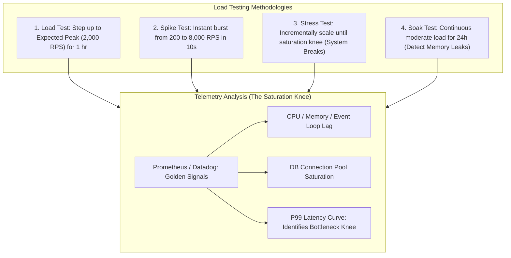

## Fast Revision (10-Second Recall)
- **The 4 Test Types:**
  1. *Load Testing:* Verifies system behavior under expected normal peak traffic (e.g., 2,000 req/sec for 1 hour).
  2. *Stress Testing:* Pushes traffic beyond expected peak until system breaks to identify breaking limits and degradation modes.
  3. *Spike Testing:* Injects sudden, violent bursts of traffic (e.g., flash sale from 100 to 10,000 req/sec in 5 seconds) to test auto-scaling responsiveness.
  4. *Soak / Endurance Testing:* Sustained moderate load over 24-48 hours to uncover slow memory leaks and file descriptor leaks.
- **Little's Law:** $L = \lambda \times W$ (Concurrency = Request Arrival Rate $\times$ Average Latency). If latency doubles, concurrency doubles for the same request rate!
- **Never Test in Production without Guardrails:** Load test in an environment with production-equivalent topology, or use dark traffic shadowing / canary routing.

## The 30-Second Spoken Script
> "Performing effective load testing requires realistic workload modeling rather than simply slamming a single endpoint with a high-speed HTTP loop.
>
> We structure load testing into four distinct stages:
> First, **Workload Modeling**: We analyze production telemetry in Datadog or Google Analytics to determine real-world traffic ratios—for example, 80% read requests, 15% search requests, and 5% checkout transactions—incorporating realistic user think-time delays.
> Second, **Test Execution Typology**: We run **Load Tests** to validate our P95 SLA under anticipated peak load; **Spike Tests** to evaluate how quickly Kubernetes HPA and cloud load balancers react to flash crowds; and **Stress Tests** to find the exact saturation knee where latency degrades exponentially.
> Third, **Bottleneck & Recovery Analysis**: We monitor the golden signals: latency, traffic, error rates, and resource saturation (CPU, memory, database connection pool, socket limits).
> Finally, we verify that when the surge subsides, the system recovers automatically without requiring manual pod restarts."

## Scenario / Problem Context
A ticketing platform prepared for a national concert tour sale. The operations team assumed their infrastructure could easily handle the traffic because they passed a load test of "5,000 requests per second."

However, during the live ticket drop, the site crashed within 45 seconds. The post-mortem revealed two critical flaws in their load testing methodology:
1. The load test script hit a static endpoint: `GET /api/v1/events/101`. Because the endpoint was cached at Cloudflare, 99% of test requests never reached the application or database.
2. Real users performed dynamic actions: authenticating, locking seats in Redis, and submitting payment transactions. The database connection pool was exhausted at only 400 concurrent checkouts, causing cascading thread pool deadlocks across the cluster.

The organization needs a realistic, multi-scenario load testing strategy that models real user behavior and identifies true database and system bottlenecks.

## Architectural Workflow / Sequence


## Deep-Dive Analysis & Root Causes

### 1. The Saturation Knee (Throughput vs Latency)
As concurrent requests increase:
- **Linear Phase:** Throughput (RPS) scales linearly with load; latency remains low and flat.
- **Saturation Knee:** System resources (CPU, DB connections, thread pools) reach maximum capacity. Throughput hits a ceiling.
- **Collapse Phase:** Any additional requests enter queues. Latency spikes exponentially, timeouts trigger client retries, and the system suffers cascading failure (meltdown).

### 2. The Fallacy of Testing Single Endpoints
Hitting a single read-only URL creates an artificial cache-hit scenario. A realistic load test scenario must execute a stateful user journey:
1. Fetch homepage -> Wait 2s (think time).
2. Authenticate -> Receive session cookie/JWT.
3. Search inventory with dynamic random query parameters (bypassing edge cache).
4. Add item to cart (Redis lock acquisition).
5. Submit checkout (Postgres transaction write).

### 3. Open vs Closed Workload Models
- **Closed Model:** Virtual users wait for a response before sending the next request. If the server slows down, the load test runner automatically slows down! (Misleadingly hides queue build-up).
- **Open Model:** Requests arrive at a fixed arrival rate regardless of whether previous requests have completed (e.g., k6 `constant-arrival-rate`). This accurately reflects real-world DDoS or flash sales.

## Practical Debugging Commands & Code

### Step 1: Realistic Multi-Scenario k6 Load Test Script
```javascript
// load-tests/ticket-checkout-journey.js
import http from 'k6/http';
import { check, sleep, group } from 'k6';
import { randomIntBetween } from 'https://jslib.k6.io/k6-utils/1.2.0/index.js';

export const options = {
  // Staged ramp-up simulating realistic peak traffic
  stages: [
    { duration: '2m', target: 500 },  // Ramp-up to 500 users
    { duration: '5m', target: 2000 }, // Peak load: 2,000 concurrent users
    { duration: '2m', target: 2000 }, // Stay at peak
    { duration: '2m', target: 0 },    // Ramp-down
  ],
  thresholds: {
    'http_req_duration': ['p(95)<300', 'p(99)<800'], // P95 under 300ms, P99 under 800ms
    'http_req_failed': ['rate<0.005'],               // Error rate under 0.5%
  },
};

const BASE_URL = __ENV.TARGET_URL || 'http://localhost:3000';

export default function () {
  const userId = `user_${__VU}_${__ITER}`;

  group('1. Browse Catalog (Read-Heavy)', () => {
    // Dynamic query parameter prevents artificial CDN edge caching
    const randomCategory = randomIntBetween(1, 100);
    const res = http.get(`${BASE_URL}/api/v1/events?category=${randomCategory}`);
    check(res, { 'events loaded': (r) => r.status === 200 });
  });

  // Realistic human think time (1 to 3 seconds)
  sleep(randomIntBetween(1, 3));

  group('2. Lock Reservation (Stateful Write)', () => {
    const payload = JSON.stringify({
      userId,
      eventId: 'evt_999',
      seatCount: 2,
    });

    const params = {
      headers: { 'Content-Type': 'application/json' },
    };

    const res = http.post(`${BASE_URL}/api/v1/reservations/hold`, payload, params);
    check(res, {
      'reservation accepted': (r) => r.status === 201 || r.status === 409, // 409 is acceptable if sold out
    });
  });

  sleep(randomIntBetween(2, 4));
}
```

### Step 2: Executing Stress Test via Docker
```bash
# Execute k6 in Docker, passing target host and outputting live metrics
docker run --rm -i \
  -v $(pwd)/load-tests:/scripts \
  grafana/k6 run /scripts/ticket-checkout-journey.js \
  -e TARGET_URL="http://host.docker.internal:3000"
```

### Step 3: Monitoring Database Connection Saturation Under Load
Run this during the load test to watch connection pool starvation in real time:

```sql
-- PostgreSQL: Monitor active connections vs pool limit
SELECT 
    count(*) total_connections,
    count(*) FILTER (WHERE state = 'active') as active_running_queries,
    count(*) FILTER (WHERE state = 'idle in transaction') as idle_in_trans_leaks,
    count(*) FILTER (WHERE wait_event_type IS NOT NULL) as waiting_queries
FROM pg_stat_activity;
```

## Prevention & Senior Best Practices
1. **Never Test with Static URLs:** Incorporate parameterized dynamic inputs, random user IDs, and unique request payloads to accurately exercise databases and bypass caching layers.
2. **Include Think Time:** Real users do not click buttons every 10 milliseconds. Include realistic 1-to-5 second jittered sleep delays between steps to model true concurrency.
3. **Use Open Workload Models for Critical Paths:** Model flash sales using arrival-rate executors (`k6 constant-arrival-rate`) so slow server responses cause request queues to build naturally, exposing backpressure weaknesses.
4. **Automate Load Tests in Pre-Release Pipelines:** Run lightweight load tests (e.g. 100 RPS for 2 minutes) on staging or canary environments before every major version release.
5. **Establish Circuit Breakers:** Protect downstream dependencies during load spikes with circuit breakers (e.g. Opossum, Resilience4j) to prevent cascading failures.

