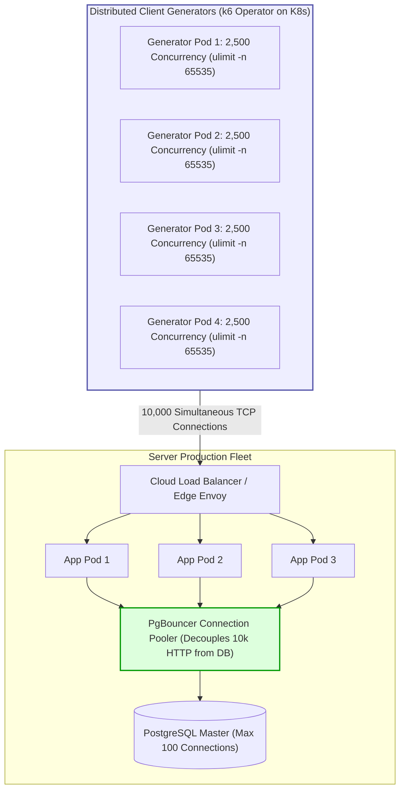

## Fast Revision (10-Second Recall)
- **10,000 Concurrent != 10,000 RPS:** 10,000 concurrent requests means 10,000 TCP sockets held open simultaneously in flight. If each request takes 200ms, that equals 50,000 RPS!
- **Client Machine Bottlenecks:** A single generator machine will exhaust file descriptors (`ulimit -n`), ephemeral TCP ports (`net.ipv4.ip_local_port_range`), and local CPU before the server even breaks.
- **Distributed Generators:** Scale generator load using multiple worker nodes (e.g. k6 Operator on Kubernetes, distributed Locust, or AWS Distributed Load Testing).
- **Server-Side Knots:** At 10k connections, un-tuned servers hit `somaxconn` backlog limits, epoll thread starvation, TCP SYN flood protection false-positives, and database connection pool exhaustion.
- **Architectural Solution:** Reverse proxy connection offloading (Nginx/Envoy), keep-alive connection reuse, asynchronous queueing, and connection pooling (PgBouncer).

## The 30-Second Spoken Script
> "Testing an API with 10,000 concurrent connections is fundamentally an exercise in infrastructure tuning for both the client generators and the server under test.
>
> First, we distinguish between 10,000 requests per second and 10,000 concurrent in-flight sockets. Sustaining 10,000 active TCP connections from a single test machine will fail locally due to OS limits—specifically default file descriptor limits (`ulimit -n 1024`) and ephemeral port exhaustion. We must tune the OS kernel parameters (`sysctl`) and distribute the load across multiple generator pods using Kubernetes k6 Operator.
>
> Second, on the server architecture, a single monolithic app process cannot hold 10,000 direct database connections. We verify that edge reverse proxies (like Envoy or Nginx) handle client connection multiplexing, keep-alive termination, and rate-limiting. For database persistence, connection poolers like PgBouncer must decouple the 10,000 HTTP client connections from the 100 physical PostgreSQL backend connections.
>
> During the test, we monitor kernel metrics: socket buffer memory, TCP TIME_WAIT states, `netstat -s` dropped packets, and CPU context switching."

## Scenario / Problem Context
A fintech platform launching an IPO allocation portal needed to verify that their submission API could withstand 10,000 concurrent users clicking "Submit Bid" at the market open bell.

The test team attempted to run `ab -c 10000 -n 50000 https://api.company.com/bid` from an engineer's MacBook. The test immediately failed with:
```text
apr_socket_recv: Connection reset by peer (54)
Test aborted after 1024 requests: socket: Too many open files (24)
```

The engineer assumed the production server had crashed. In reality, the server had received zero requests—the test generator machine itself had hit its macOS file descriptor ceiling!

The team requires an enterprise testing design capable of generating and sustaining 10,000 genuine concurrent connections while monitoring both client and server health.

## Architectural Workflow / Sequence


## Deep-Dive Analysis & Root Causes

### 1. Client-Side Bottlenecks (Why 10k Fails Locally)
- **File Descriptors (`ulimit -n`):** Every TCP socket is a file descriptor in Unix. The default is usually 1,024. Attempting 10,000 connections throws `EMFILE: Too many open files`.
- **Ephemeral Port Exhaustion:** Outgoing connections bind to ephemeral ports (default range ~32,768 to 60,999 = ~28,000 available ports). If connections cycle quickly through `TIME_WAIT`, the client exhausts source ports.
- **CPU Starvation:** Generating TLS handshakes for 10,000 concurrent sockets on a single laptop consumes 100% CPU, artificially distorting latency measurements.

### 2. Server-Side Bottlenecks at 10,000 Concurrency
- **Listen Backlog Queue (`somaxconn`):** When thousands of connections arrive simultaneously, the kernel TCP SYN queue fills up. The server silently drops new SYN packets, causing client timeouts.
- **Thread-per-Connection Trap:** Architectures using thread-per-request models (e.g. traditional Apache or default Spring Tomcat) try to allocate 10,000 OS threads (each needing 1MB stack = 10GB RAM just for thread stacks!). Modern event-driven engines (Node.js, Netty, Go goroutines, Nginx) are mandatory.
- **Database Connection Collapse:** If the application tries to open 10,000 connections to PostgreSQL, Postgres memory exhausts and crashes. A pooling layer like PgBouncer is non-negotiable.

## Practical Debugging Commands & Code

### Step 1: OS Kernel Tuning for High Concurrency (Client & Server)
Apply these `sysctl` settings on load generator and server nodes:

```bash
# Increase system-wide open file descriptors
sudo sysctl -w fs.file-max=2097152

# Increase user file descriptor limits in /etc/security/limits.conf
# * soft nofile 65535
# * hard nofile 65535
ulimit -n 65535

# Widen ephemeral port range
sudo sysctl -w net.ipv4.ip_local_port_range="1024 65535"

# Enable fast recycling of TIME_WAIT sockets
sudo sysctl -w net.ipv4.tcp_tw_reuse=1

# Expand TCP listen backlog queue (prevent connection drops during bursts)
sudo sysctl -w net.core.somaxconn=65535
sudo sysctl -w net.ipv4.tcp_max_syn_backlog=65535
```

### Step 2: Distributed Concurrency Script in k6
```javascript
// load-tests/10k-concurrency.js
import http from 'k6/http';
import { check, sleep } from 'k6';

export const options = {
  scenarios: {
    constant_concurrency: {
      executor: 'constant-vus',
      vus: 10000, // 10,000 active concurrent connections
      duration: '5m',
    },
  },
  thresholds: {
    'http_req_duration': ['p(95)<500', 'p(99)<1500'],
    'http_req_failed': ['rate<0.01'],
  },
};

export default function () {
  const payload = JSON.stringify({
    bidAmount: 1500,
    timestamp: Date.now(),
  });

  const params = {
    headers: {
      'Content-Type': 'application/json',
      'Connection': 'keep-alive', // Reuse sockets to avoid port exhaustion
    },
    timeout: '10s',
  };

  const res = http.post('https://api-target.internal/api/v1/bids', payload, params);

  check(res, {
    'status is 200 or 201': (r) => r.status === 200 || r.status === 201,
  });

  // Small sleep to maintain steady concurrent in-flight state without DOSing network
  sleep(1);
}
```

### Step 3: Kubernetes k6 Operator for Distributed Generation
Run 4 pods generating 2,500 VUs each:

```yaml
apiVersion: k6.io/v1alpha1
kind: K6
metadata:
  name: distributed-10k-load
spec:
  parallelism: 4 # Spawns 4 worker pods (2,500 VUs per pod = 10,000 total)
  script:
    configMap:
      name: k6-test-script
      file: 10k-concurrency.js
  arguments: --out statsd
```

### Step 4: Monitor Connection States on Server
```bash
# Check count of connections in ESTABLISHED, TIME_WAIT, and SYN_RECV
netstat -nat | awk '{print $6}' | sort | uniq -c | sort -n

# Inspect dropped connections due to listen queue overflow
netstat -s | grep -i "listen"
# Output shows: "X times the listen queue of a socket overflowed"
```

## Prevention & Senior Best Practices
1. **Never Run 10k Concurrency from a Single Machine:** Distribute load generation across a cluster of nodes to prevent client-side socket saturation from corrupting test validity.
2. **Mandate Connection Keep-Alive:** Configure clients and proxies to reuse existing TCP connections, eliminating the massive CPU overhead of repeated TLS handshakes.
3. **Decouple HTTP Connections from DB Connections:** Never map incoming HTTP requests 1:1 to database connections. Route through a connection multiplexer like PgBouncer or an internal queue.
4. **Implement Graceful Load Shedding:** Protect servers from collapse at 10,000 concurrency by rejecting overflow requests with HTTP 429 or HTTP 503 before internal queues cause process memory crashes.
5. **Verify Edge Proxy Connection Limits:** Ensure Cloudflare, AWS ALB, or Envoy reverse proxies have their `max_connections` and worker connection limits set high enough to accommodate 10k+ concurrent sockets.

