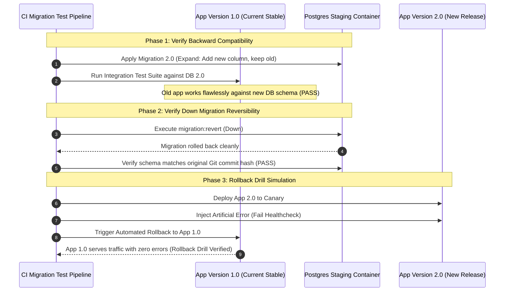

## Fast Revision (10-Second Recall)
- **The Golden Rollback Rule:** Code can be rolled back in 30 seconds; data cannot. Database schema changes must **always** be backward-compatible with previous application code.
- **The Expand-Contract (Parallel Run) Pattern:** Never alter or drop existing database columns in the same release. Phase 1: Expand (add new optional column). Phase 2: Deploy code writing to both. Phase 3: Contract (remove old column only after rollback window closes).
- **Testing "Down" Migrations:** Automate `migration:run` followed immediately by `migration:revert` in CI to verify that down migrations do not fail with foreign key or syntax errors.
- **Testing Rollback of Running Workflows:** Assert that in-flight jobs or asynchronous background tasks created by v2.0 can still be parsed and processed if the fleet is rolled back to v1.0.
- **Rollback Game Days:** Intentionally trigger rollback drills in staging/pre-production every quarter to verify team runbooks and pipeline automation.

## The 30-Second Spoken Script
> "Testing a rollback requires far more than just verifying that `kubectl rollout undo` switches container tags. The real challenge of rollbacks is data and contract survivability.
>
> In high-reliability engineering, we follow three core testing practices:
> First, **Database Migration Reversibility**: We enforce automated migration rollback tests in CI. For every database migration PR, our pipeline runs the migration `up`, runs the migration `down`, and verifies that the database schema returns to the exact initial checksum without data corruption or constraint violations.
> Second, **The Expand-Contract Pattern**: We enforce that new database schemas must remain fully backward-compatible with the old application version. We test this by running the new database migration against the staging database while keeping the **old application code** running. If the old application throws errors, the migration fails review.
> Third, **Production Rollback Drills (Game Days)**: We regularly rehearse release rollbacks in pre-production. We intentionally trigger simulated deployment failures, verify that our automated rollback monitors trigger within 60 seconds, and assert that user sessions, in-flight background queues, and payment transactions remain intact."

## Scenario / Problem Context
An enterprise SaaS platform deployed version 2.4.0 on Tuesday night. The release included a database migration that renamed a column from `customer_phone` to `phone_e164`:
```sql
-- DANGEROUS: Instant breaking rename
ALTER TABLE customers RENAME COLUMN customer_phone TO phone_e164;
```

Ten minutes after release, a severe memory leak in version 2.4.0 forced the DevOps lead to execute a rollback:
```bash
kubectl rollout undo deployment/api-service
```

The container successfully rolled back to version 2.3.0 in 20 seconds. However, version 2.3.0 immediately crashed across 100% of pods! Its SQL queries still executed:
`SELECT id, customer_phone FROM customers`
Because the database column had been renamed to `phone_e164`, the rolled-back version could not boot. The team could neither move forward nor roll back, resulting in a 5-hour emergency maintenance window.

The organization needs a verifiable testing framework that guarantees every deployment can be rolled back safely at any time.

## Architectural Workflow / Sequence


## Deep-Dive Analysis & Root Causes

### 1. Breaking Database Changes (The Anti-Pattern)
Any migration that does the following is inherently un-rollbackable:
- Renaming columns or tables (`ALTER TABLE ... RENAME`).
- Adding `NOT NULL` columns without a default value.
- Dropping columns or foreign keys.
- Changing column data types (e.g., `VARCHAR` to `INTEGER`).

### 2. The Expand-Contract Phase Matrix
To ensure safe rollbacks, every breaking change must be split into three independent releases:
1. **Release 1 (Expand):** Add the new column `phone_e164` (nullable). Old code ignores it.
2. **Release 2 (Transition):** Deploy code that reads from either column and writes to both. Data backfill runs in background.
3. **Release 3 (Contract):** Deploy code that uses only `phone_e164`. Drop old `customer_phone` column only after Release 2 has been stable in production for at least 2 weeks.

### 3. Testing Message Queue Compatibility
If Version 2.0 enqueues messages with a new JSON schema into Kafka or RabbitMQ, and you roll back to Version 1.0:
- Can Version 1.0 workers parse the messages produced by Version 2.0?
- If Version 1.0 crashes with `Unexpected field` or `JSON parse error`, the rollback has failed.
- Test that serializers ignore unknown fields (`@JsonIgnoreProperties(ignoreUnknown = true)`).

## Practical Debugging Commands & Code

### Step 1: Automated Migration Up/Down Reversibility CI Test
Run this script in CI to guarantee that every migration can roll back cleanly:

```bash
#!/usr/bin/env bash
# test-migration-reversibility.sh
set -euo pipefail

echo "1. Applying all current database migrations..."
npm run typeorm migration:run

echo "2. Capturing database schema snapshot..."
pg_dump -s -h localhost -U test testdb > schema_before.sql

echo "3. Reverting the latest migration..."
npm run typeorm migration:revert

echo "4. Re-applying the latest migration (verifying idempotent re-run)..."
npm run typeorm migration:run

echo "5. Re-reverting the migration..."
npm run typeorm migration:revert

echo "6. Checking schema equality..."
pg_dump -s -h localhost -U test testdb > schema_after.sql

if diff schema_before.sql schema_after.sql > /dev/null; then
  echo "SUCCESS: Migration up/down cycle is completely reversible and deterministic."
else
  echo "CRITICAL: Schema drift detected after migration:revert!"
  diff -u schema_before.sql schema_after.sql
  exit 1
fi
```

### Step 2: Backward Compatibility Integration Test in Vitest
Assert that old entity models can read and write to the upgraded schema:

```typescript
// tests/migrations/backwardCompatibility.spec.ts
import { describe, it, expect, beforeAll } from 'vitest';
import { DataSource } from 'typeorm';
import { getTestDb } from '../test-helpers/test-db';

describe('Database Migration Backward Compatibility Check', () => {
  let db: DataSource;

  beforeAll(async () => {
    db = await getTestDb();
    // Run the newly proposed migration (v2.0)
    await db.runMigrations();
  });

  it('allows legacy v1.0 queries to function without column missing errors', async () => {
    // Simulate query generated by previous production code (v1.0)
    const legacyQuery = `
      INSERT INTO customers (id, name, customer_phone)
      VALUES ($1, $2, $3)
      RETURNING id, customer_phone;
    `;

    const res = await db.query(legacyQuery, ['cust_101', 'Legacy User', '+1-555-0199']);

    expect(res).toBeDefined();
    expect(res[0].customer_phone).toBe('+1-555-0199');
  });
});
```

### Step 3: Kubernetes Rollback Simulation Drill
```bash
# 1. Trigger rolling update to faulty image
kubectl set image deployment/api-service api=api-service:v2.4.0-faulty -n staging

# 2. Monitor rollout status
kubectl rollout status deployment/api-service -n staging

# 3. Simulate detection of production errors and trigger instant rollback
echo "Simulating automated rollback trigger..."
kubectl rollout undo deployment/api-service -n staging

# 4. Verify traffic returns cleanly to stable revision
kubectl rollout status deployment/api-service -n staging --watch=false
curl -f http://api-staging.internal/healthz && echo "Rollback successful!"
```

## Prevention & Senior Best Practices
1. **Ban Direct Column Renames:** Enforce database migration linters (e.g., `squawk` or `atlas lint`) in CI that fail builds if a migration contains `ALTER TABLE ... RENAME`.
2. **Never Drop Columns in Same Release:** Always use the Expand-Contract pattern. Wait at least one release cycle before contracting old columns.
3. **Automate Up-Down-Up Migration Tests:** Every pull request containing database migrations must pass automated up/down/re-up testing in CI.
4. **Ignore Unknown JSON Properties in Consumers:** Configure all API and message queue serializers to ignore unrecognized properties, ensuring backward compatibility with future payload schemas.
5. **Conduct Quarterly Rollback Game Days:** Intentionally trigger rollbacks in pre-production environments to measure Time to Recover (TTR) and ensure runbooks remain accurate.

