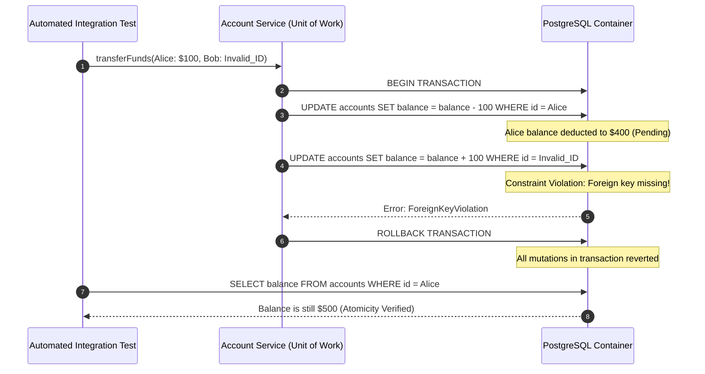

## Fast Revision (10-Second Recall)
- **The Core Transaction Question:** Does the database guarantee **Atomicity** (all operations succeed or all roll back together) and correct **Isolation** under concurrent execution?
- **Testing Atomicity:** Force an unhandled exception or constraint violation halfway through a multi-step operation; verify that earlier steps were rolled back cleanly without leaving orphan records.
- **Testing Isolation Levels:** Run two concurrent connections on separate threads/promises to verify dirty reads, non-repeatable reads, or phantom reads based on the configured isolation level (`READ COMMITTED`, `REPEATABLE READ`, `SERIALIZABLE`).
- **Deadlock Testing:** Deliberately acquire row locks in reverse order across two simultaneous transactions to verify application retry mechanisms or error handling.
- **Fast Test Cleanup via Nested Transactions:** Wrap every integration test in an outer transaction/SAVEPOINT that rolls back in `afterEach()`, achieving zero-cost database reset.

## The 30-Second Spoken Script
> "Testing database transactions requires moving beyond simple happy-path assertions to verify ACID guarantees under failure and concurrency.
>
> To test **Atomicity and Rollbacks**, we deliberately inject a failure—such as a database unique constraint violation or an intentional runtime error—after the first write operation (e.g., deducting an account balance) but before the second write (e.g., crediting the recipient). We then query the database to verify that the first write was completely undone and no orphan records exist.
>
> To test **Isolation and Concurrency**, we execute two concurrent database sessions simultaneously. We test for race conditions—such as double-spending a wallet or booking the same flight seat twice—verifying that row-level locking (`SELECT FOR UPDATE`) or optimistic concurrency version checks properly block or reject the second concurrent transaction.
>
> Finally, for test performance, we use **transactional rollbacks** to keep integration test suites fast: each test runs inside a transaction that is rolled back at the end, eliminating expensive `TRUNCATE` operations while keeping the database pristine."

## Scenario / Problem Context
A banking microservice implemented an account transfer endpoint:
1. Deduct $100 from Account A.
2. Add $100 to Account B.
3. Insert an audit log in `transfer_ledger`.

During a high-volume trading day, a user transferred money to an invalid account number. Step 1 succeeded, but Step 2 threw a foreign key violation (`account_id does not exist`). 

Because the developer had not wrapped the operations in an explicit database transaction (`BEGIN ... COMMIT`), Step 1 remained committed to the database! The customer's account lost $100, the recipient received nothing, and no audit record was written.

The team needs an automated integration testing framework that tests transaction rollbacks, isolation levels, and concurrent deadlocks reliably.

## Architectural Workflow / Sequence


## Deep-Dive Analysis & Root Causes

### 1. The Partial Commit Trap
When multiple queries are executed without an explicit transaction context, each SQL statement runs in auto-commit mode. If statement 3 fails, statements 1 and 2 are permanently committed, causing database state corruption.

### 2. Concurrency & Race Conditions (Lost Updates)
When two requests read balance = $100 simultaneously:
- Request 1 deducts $50 -> Writes $50.
- Request 2 deducts $30 -> Writes $70.
- Result: The account has $70 instead of $20! (Lost update anomaly).
- Transaction testing must run concurrent operations and verify pessimistic locking (`SELECT ... FOR UPDATE`) or optimistic concurrency control (`WHERE version = 1`).

### 3. Fast Test Isolation via Nested Transactions (SAVEPOINT)
Running `TRUNCATE` or `DELETE FROM table` after every test is extremely slow (taking hundreds of milliseconds per test). Wrapping each test in `BEGIN` and calling `ROLLBACK` in `afterEach()` resets state in under 5 milliseconds.

## Practical Debugging Commands & Code

### Step 1: Testing Atomicity & Rollback Integrity
Test that intermediate operations are undone when an error is thrown:

```typescript
// tests/integration/transferService.spec.ts
import { DataSource } from 'typeorm';
import { TransferService } from '../../src/services/TransferService';
import { Account } from '../../src/entities/Account';
import { getTestDb } from '../test-helpers/test-db';

describe('TransferService Transaction Atomicity', () => {
  let db: DataSource;
  let service: TransferService;

  beforeAll(async () => {
    db = await getTestDb();
    service = new TransferService(db);
  });

  it('rolls back balance deduction when ledger audit write fails', async () => {
    // 1. Seed test accounts
    const accountRepo = db.getRepository(Account);
    const alice = await accountRepo.save({ name: 'Alice', balance: 500 });
    const bob = await accountRepo.save({ name: 'Bob', balance: 200 });

    // 2. Mock or force the ledger to fail on save
    jest.spyOn(service.ledgerRepo, 'recordAudit').mockRejectedValueOnce(
      new Error('Simulated disk/database failure on audit write')
    );

    // 3. Execute transfer and expect failure
    await expect(
      service.transferMoney({
        fromAccountId: alice.id,
        toAccountId: bob.id,
        amount: 100,
      })
    ).rejects.toThrow('Simulated disk/database failure on audit write');

    // 4. Assert Atomicity: Alice balance MUST NOT have changed!
    const reloadedAlice = await accountRepo.findOneBy({ id: alice.id });
    const reloadedBob = await accountRepo.findOneBy({ id: bob.id });

    expect(reloadedAlice?.balance).toBe(500); // Intact!
    expect(reloadedBob?.balance).toBe(200);   // Intact!
  });
});
```

### Step 2: Testing Concurrency and Pessimistic Locking
Test that concurrent balance deductions cannot overdraft the account:

```typescript
// tests/integration/concurrentTransfer.spec.ts
it('prevents double-spend overdraft using SELECT FOR UPDATE pessimistic locking', async () => {
  const accountRepo = db.getRepository(Account);
  const user = await accountRepo.save({ name: 'Charlie', balance: 100 });

  // Fire two concurrent requests trying to withdraw $100 simultaneously
  const request1 = service.withdrawWithPessimisticLock(user.id, 100);
  const request2 = service.withdrawWithPessimisticLock(user.id, 100);

  const results = await Promise.allSettled([request1, request2]);

  const fulfilled = results.filter(r => r.status === 'fulfilled');
  const rejected = results.filter(r => r.status === 'rejected');

  // Exactly ONE request must succeed; the other must be rejected for insufficient funds
  expect(fulfilled.length).toBe(1);
  expect(rejected.length).toBe(1);

  const finalUser = await accountRepo.findOneBy({ id: user.id });
  expect(finalUser?.balance).toBe(0); // Balance cannot be negative (-100)
});
```

### Step 3: Fast Zero-Cost Test Cleanup via Transaction Rollback Pattern
```typescript
// test-helpers/transactionTestWrapper.ts
import { DataSource, QueryRunner } from 'typeorm';

export function setupTransactionalTest(dataSource: DataSource) {
  let queryRunner: QueryRunner;

  beforeEach(async () => {
    queryRunner = dataSource.createQueryRunner();
    await queryRunner.connect();
    // Begin outer transaction for test isolation
    await queryRunner.startTransaction();
  });

  afterEach(async () => {
    // Roll back everything executed during the test in milliseconds
    await queryRunner.rollbackTransaction();
    await queryRunner.release();
  });

  return () => queryRunner.manager;
}
```

## Prevention & Senior Best Practices
1. **Always Use Unit of Work / Transaction Managers:** Never execute raw multi-statement queries without wrapping them in an explicit transaction manager (`dataSource.transaction()`).
2. **Explicitly Set Isolation Levels:** Do not assume the database default isolation level is sufficient for financial or inventory transactions. Explicitly request `SERIALIZABLE` or use explicit `SELECT ... FOR UPDATE` row locks.
3. **Keep Transactions as Short as Possible:** Never make external HTTP calls, send emails, or perform heavy CPU processing inside an open database transaction. Acquire locks, execute SQL, and commit immediately.
4. **Order Lock Acquisition to Prevent Deadlocks:** When acquiring multiple locks (e.g. transferring between Account A and Account B), always lock rows in a deterministic order (e.g., `ORDER BY id ASC`) to eliminate circular wait conditions.
5. **Enforce Database Constraints as Fallbacks:** Always back up application business logic with database-level `CHECK` constraints (e.g., `CHECK (balance >= 0)`) so the database rejects invalid state even if application locks fail.

