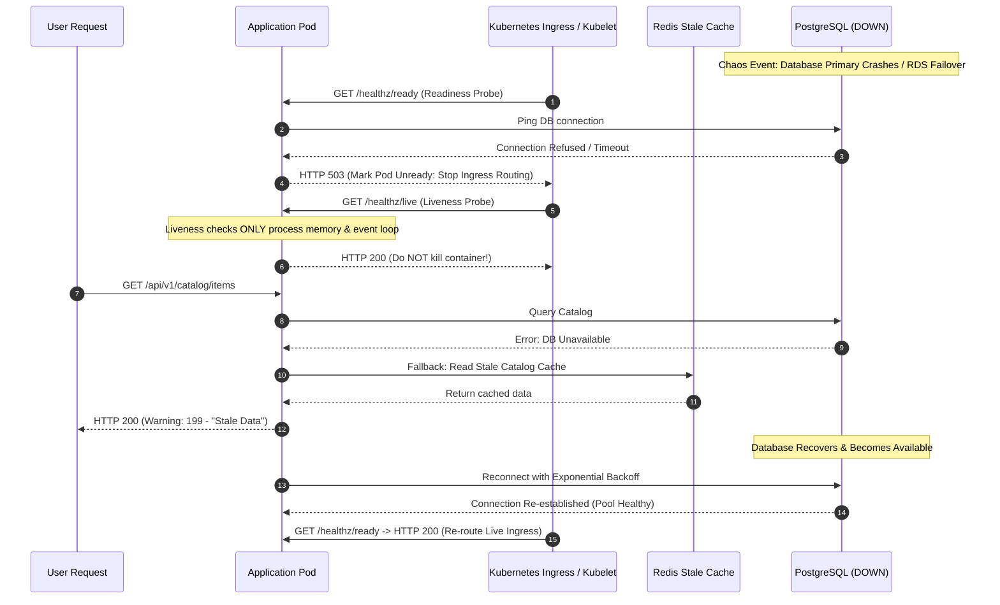

## Fast Revision (10-Second Recall)
- **The Core Dilemma:** When the database goes down, should the application crash (`CrashLoopBackOff`) or enter a graceful degraded mode?
- **Liveness vs Readiness Probe Distinction:**
  - *Liveness Probe:* MUST NOT check database connectivity. If it does, a DB outage kills all pods simultaneously, destroying the cluster.
  - *Readiness Probe:* MUST check database connectivity. If the DB is down, mark the pod as unready to remove it from ingress routing without killing the container.
- **Graceful Degradation Tactics:** Read from stale Redis/CDN cache, return cached product catalogues, queue critical incoming writes to durable local disk/Kafka, and return informative HTTP 503 Service Unavailable envelopes.
- **Chaos Simulation:** Stop the database Docker container (`docker stop postgres`), drop TCP packets via iptables, or fill the connection pool to capacity.
- **Recovery Testing:** Verify that once the database recovers, the application reconnects automatically without requiring manual pod restarts.

## The 30-Second Spoken Script
> "Testing how an application behaves when its database is unavailable is a litmus test for production resilience. The worst mistake a team can make during a database outage is having the application crash or cascade into a cluster-wide restart storm.
>
> We test database outage resilience across four critical areas:
> First, **Kubernetes Probe Segregation**: We verify that the **Liveness probe** only checks internal process health, while the **Readiness probe** checks database reachability. If the database goes offline, the pods stop accepting traffic, but Kubernetes does not repeatedly kill and restart them, which would exhaust memory and CPU.
> Second, **Graceful Degradation & Read Caching**: We test that read-heavy endpoints fall back to stale Redis caches or local in-memory buffers with a `stale: true` indicator, allowing visitors to continue browsing products even if the primary database is offline.
> Third, **Write Resiliency & Queuing**: For mission-critical write operations (such as telemetry, audit logs, or cart additions), we verify that mutations are temporarily written to a durable Kafka queue or local disk buffer to prevent data loss.
> Finally, **Automated Reconnection**: We stop the PostgreSQL container for 60 seconds, bring it back up, and assert that the application's ORM or connection pool (HikariCP, TypeORM, Prisma) recovers automatically without dropping subsequent requests."

## Scenario / Problem Context
A cloud SaaS platform experienced a routine 90-second Amazon RDS failover. Although the database switchover took under 2 minutes, the customer outage lasted over 45 minutes.

The post-mortem revealed two catastrophic bugs:
1. The Kubernetes `livenessProbe` checked `SELECT 1` on the database. When RDS failed over, all 80 API pods failed liveness simultaneously. Kubernetes killed all 80 containers. When the containers restarted, they tried to reconnect to the recovering database simultaneously, causing a thundering herd SYN-flood that kept both the DB and the application in a deadlock restart loop.
2. The Node.js database pool had `reconnectTries: 3` with no exponential backoff. Once the 3 retries were exhausted in 1.5 seconds, the application threw an uncaught fatal exception and terminated permanently.

The organization needs a chaos testing procedure to ensure the application degrades gracefully during database outages and reconnects cleanly upon restoration.

## Architectural Workflow / Sequence


## Deep-Dive Analysis & Root Causes

### 1. The Liveness Probe Trap
Checking external dependencies (DB, Redis, third-party APIs) in Kubernetes `livenessProbe` is an anti-pattern. If the database goes down:
- All pods fail liveness.
- Kubelet kills all containers.
- CPU/Memory resources are wasted restarting pods that will instantly fail anyway.
- Once the database recovers, it is overwhelmed by thousands of containers booting simultaneously.
- **Rule:** Liveness = "Is the process alive and responsive?" Readiness = "Is the process ready to accept user requests?"

### 2. Connection Pool Deadlocks on Outage
When the database drops connection:
- Running queries throw connection errors (`ECONNREFUSED`, `57P01: admin shutdown`).
- If connection pools do not implement automatic reconnection loops or health validation (`testOnBorrow`), connections remain in stale broken states forever.

### 3. Graceful Read Fallbacks (Stale-While-Revalidate)
For read operations, an application can serve cached data with appropriate HTTP headers:
`Warning: 110 - "Response is Stale"`
This allows users to continue browsing while the database is restored.

## Practical Debugging Commands & Code

### Step 1: Automated Integration Test for DB Outage & Reconnection
Use Testcontainers to programmatically stop and start the database during a live test:

```typescript
// tests/chaos/databaseOutage.chaos.spec.ts
import { describe, it, expect, beforeAll, afterAll } from 'vitest';
import { PostgreSqlContainer, StartedPostgreSqlContainer } from '@testcontainers/postgresql';
import { DataSource } from 'typeorm';
import { HealthService } from '../../src/services/HealthService';
import { CatalogService } from '../../src/services/CatalogService';

describe('Chaos Test: Database Complete Outage & Recovery', () => {
  let container: StartedPostgreSqlContainer;
  let dataSource: DataSource;
  let healthService: HealthService;
  let catalogService: CatalogService;

  beforeAll(async () => {
    container = await new PostgreSqlContainer('postgres:16-alpine').start();

    dataSource = new DataSource({
      type: 'postgres',
      host: container.getHost(),
      port: container.getPort(),
      username: container.getUsername(),
      password: container.getPassword(),
      database: container.getDatabase(),
      // Reconnection settings
      extra: {
        max: 10,
        connectionTimeoutMillis: 2000,
      },
    });

    await dataSource.initialize();
    healthService = new HealthService(dataSource);
    catalogService = new CatalogService(dataSource);
  }, 45000);

  afterAll(async () => {
    if (dataSource.isInitialized) await dataSource.destroy();
    await container.stop();
  });

  it('1. Liveness returns 200 but Readiness returns 503 when DB container is stopped', async () => {
    // Verify healthy initial baseline
    expect((await healthService.checkLiveness()).isAlive).toBe(true);
    expect((await healthService.checkReadiness()).isReady).toBe(true);

    // Chaos Injection: Abruptly pause the PostgreSQL container
    await container.getDockerClient().api.getContainer(container.getId()).pause();

    // 1. Liveness MUST stay TRUE (do not kill the pod!)
    const liveness = await healthService.checkLiveness();
    expect(liveness.isAlive).toBe(true);

    // 2. Readiness MUST become FALSE (remove from router)
    const readiness = await healthService.checkReadiness();
    expect(readiness.isReady).toBe(false);
    expect(readiness.error).toMatch(/Database ping failed/);

    // 3. Unpause / Restore the DB container
    await container.getDockerClient().api.getContainer(container.getId()).unpause();

    // 4. Assert automatic reconnection without app restart
    const restoredReadiness = await healthService.checkReadiness();
    expect(restoredReadiness.isReady).toBe(true);
  });

  it('2. Serves stale cache when primary DB fails on read requests', async () => {
    // Seed item in local cache
    catalogService.cache.set('item_42', { id: 'item_42', name: 'Vintage Camera', price: 120 });

    // Simulate DB query failure
    jest.spyOn(dataSource, 'query').mockRejectedValueOnce(new Error('Connection terminated'));

    const result = await catalogService.getItemById('item_42');

    // Asserts fallback to stale cache
    expect(result.data.name).toBe('Vintage Camera');
    expect(result.isDegradedStaleData).toBe(true);
  });
});
```

### Step 2: Proper Kubernetes Health Probe Configuration
Ensure your deployment YAML separates liveness and readiness cleanly:

```yaml
apiVersion: apps/v1
kind: Deployment
metadata:
  name: api-service
spec:
  template:
    spec:
      containers:
        - name: app
          image: api-service:v1.2.0
          # Liveness Probe: Checks only internal node process health
          livenessProbe:
            httpGet:
              path: /healthz/live
              port: 8080
            initialDelaySeconds: 10
            periodSeconds: 10
            failureThreshold: 3
          # Readiness Probe: Checks database reachability
          readinessProbe:
            httpGet:
              path: /healthz/ready
              port: 8080
            initialDelaySeconds: 5
            periodSeconds: 5
            failureThreshold: 2
```

### Step 3: Simulating DB Disconnection via iptables
```bash
# On a staging server: block PostgreSQL outbound port 5432
sudo iptables -A OUTPUT -p tcp --dport 5432 -j DROP

# Check that application readiness probe drops to 503 while logs log reconnect attempts
curl -I http://localhost:8080/healthz/ready

# Restore connectivity
sudo iptables -D OUTPUT -p tcp --dport 5432 -j DROP
```

## Prevention & Senior Best Practices
1. **Never Check External Databases in Liveness Probes:** Liveness probes must only check that the internal process event loop and memory are healthy. Keep database checks strictly in readiness probes.
2. **Configure Continuous Reconnection with Jitter:** Ensure database connection pools (TypeORM, Prisma, HikariCP) reconnect automatically with infinite retries and randomized backoff.
3. **Graceful Stale Fallbacks for Read APIs:** For public catalog and content endpoints, serve cached data from Redis or in-memory caches when database queries time out.
4. **Buffer Writes in Message Queues:** Ingest critical events into Kafka or Redis Streams before writing to the database, ensuring zero data loss during database failovers.
5. **Set Conservative Query and Connection Timeouts:** Set database connection acquisition timeouts to 2-3 seconds, failing fast rather than hanging incoming HTTP request threads indefinitely.

