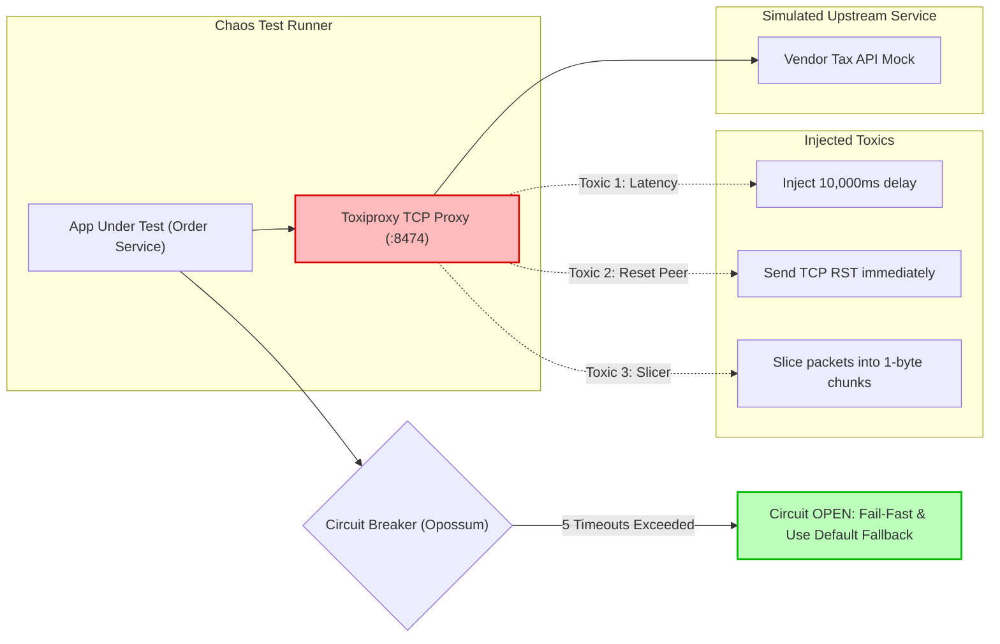

## Fast Revision (10-Second Recall)
- **The Fallacy of Happy Networks:** Networks are inherently unreliable. Distributed systems must be tested against packet loss, socket hang-ups, DNS NXDOMAIN, and slow socket responses.
- **Top 5 Network Failures to Test:**
  1. *Connection Timeout:* TCP SYN handshake fails or times out.
  2. *Read/Socket Timeout:* Connection established, but upstream never returns headers/body within SLA.
  3. *Socket Reset (ECONNRESET):* Upstream process crashes abruptly and sends TCP RST.
  4. *DNS Resolution Failure (ENOTFOUND):* Domain name cannot be resolved.
  5. *Slow Drip Attack:* Upstream sends 1 byte every 5 seconds, tying up server worker threads.
- **Architectural Protections:** Explicit client timeouts (Connect: 1s, Read: 3s), exponential backoff with jitter, and circuit breakers (Opossum, Resilience4j).
- **Chaos Tooling:** Toxiproxy, Chaos Mesh, MSW network error simulation, or Linux `tc` (Traffic Control).

## The 30-Second Spoken Script
> "Testing how an application behaves when a network request fails is critical for preventing cascading outages in microservices. A single unhandled timeout can cause worker threads to hang, exhaust connection pools, and bring down the entire cluster.
>
> We test network failures at three distinct levels:
> First, in **Integration Tests**, we use tools like **MSW** or **Nock** to inject specific network errors: simulating `ECONNRESET`, `ETIMEDOUT`, DNS `ENOTFOUND`, and malformed TCP payloads. We verify that our application catches the error, wraps it in domain exceptions, and returns clean fallbacks rather than unhandled promise rejections.
> Second, for **Chaos & Resilience Testing**, we use **Toxiproxy**. Toxiproxy sits as a TCP proxy between our service and dependencies, allowing us to dynamically inject network conditions like latency spikes, packet drops, bandwidth limits, and abrupt connection cuts.
> Third, we test **Circuit Breakers and Retries**. We assert that after 5 consecutive network timeouts, the circuit opens, failing fast immediately without wasting network sockets, and that retries use exponential backoff with randomized jitter to prevent thundering herds."

## Scenario / Problem Context
An order service called an external tax calculation API to compute sales tax before checkout. The tax API provider suffered a major network outage: instead of returning HTTP 500 or failing TCP connections, their edge router accepted TCP handshakes but never sent an HTTP response byte.

The order service used the default HTTP client without an explicit socket timeout:
```typescript
// DANGEROUS: Default Node.js / Axios has NO timeout by default!
const taxResult = await axios.post('https://tax-api.vendor.com/calculate', payload);
```

Every incoming user checkout spawned an HTTP connection that remained open indefinitely. Within 3 minutes, all 200 Node.js HTTP agent sockets were occupied. The order service stopped accepting incoming traffic, and the entire e-commerce checkout went down for 4 hours.

The team needs an automated test suite that asserts explicit timeouts, validates retry and circuit breaker logic, and simulates chaotic network drops.

## Architectural Workflow / Sequence


## Deep-Dive Analysis & Root Causes

### 1. Connect Timeout vs Read/Socket Timeout
- **Connect Timeout:** Time allowed to establish the TCP 3-way handshake and TLS negotiation (typically 500ms to 1s).
- **Read/Socket Timeout:** Time allowed between receiving data packets once the connection is established (typically 2s to 5s).
- Default HTTP clients often have **infinite** timeouts! A production client must always configure both explicitly.

### 2. Cascading Failures and Thread Starvation
When upstream calls hang:
1. Sockets remain open.
2. Thread pools (in JVM) or heap memory allocations (in Node.js) remain locked.
3. Ingress requests queue up.
4. Kubernetes liveness probes fail because the event loop is saturated.
5. The container is killed and restarts in a loop (`CrashLoopBackOff`).

### 3. Circuit Breaker State Machine
- **CLOSED:** Normal operations. Requests pass through to upstream.
- **OPEN:** After $N$ failures/timeouts (e.g. 50% failure rate over 10s), the circuit opens. Requests fail immediately with a local fallback, sparing the upstream service and protecting local resources.
- **HALF-OPEN:** After a cooldown window (e.g., 30s), a small sample of probe requests are allowed through. If they succeed, the circuit closes; if they fail, it reopens.

## Practical Debugging Commands & Code

### Step 1: Testing Explicit Network Timeouts with MSW / Vitest
```typescript
// tests/integration/taxClient.timeout.spec.ts
import { describe, it, expect, beforeAll, afterAll, afterEach } from 'vitest';
import { setupServer } from 'msw/node';
import { http, HttpResponse, delay } from 'msw';
import { TaxCalculatorClient } from '../../src/clients/TaxCalculatorClient';

const server = setupServer(
  // Simulate an upstream service that hangs for 10 seconds
  http.post('https://api.taxvendor.com/calculate', async () => {
    await delay(10000);
    return HttpResponse.json({ taxRate: 0.08 });
  })
);

beforeAll(() => server.listen());
afterEach(() => server.resetHandlers());
afterAll(() => server.close());

describe('TaxCalculatorClient Resiliency', () => {
  it('aborts and throws RequestTimeoutException when upstream takes longer than 2,000ms', async () => {
    // Client configured with strict 2,000ms timeout
    const client = new TaxCalculatorClient({ timeoutMs: 2000 });

    const startTime = Date.now();

    await expect(
      client.calculateTax({ amountCents: 10000, postalCode: '90210' })
    ).rejects.toThrow(/Request timed out after 2000ms/);

    const elapsed = Date.now() - startTime;
    // Assert client aborted cleanly around 2,000ms, not hanging for 10,000ms
    expect(elapsed).toBeGreaterThanOrEqual(1900);
    expect(elapsed).toBeLessThan(3000);
  });

  it('handles abrupt connection reset (ECONNRESET) cleanly', async () => {
    server.use(
      http.post('https://api.taxvendor.com/calculate', () => {
        return HttpResponse.error(); // Simulates network drop / socket closed
      })
    );

    const client = new TaxCalculatorClient({ timeoutMs: 2000 });

    await expect(
      client.calculateTax({ amountCents: 10000, postalCode: '90210' })
    ).rejects.toThrow(/Network connection failed/);
  });
});
```

### Step 2: Testing Circuit Breaker Tripping with Opossum
```typescript
// tests/integration/circuitBreaker.spec.ts
import CircuitBreaker from 'opossum';
import { describe, it, expect } from 'vitest';

describe('Circuit Breaker Resilience', () => {
  it('trips to OPEN state after 3 consecutive network failures and returns fallback', async () => {
    let failureCount = 0;
    const unreliableNetworkCall = async () => {
      failureCount++;
      throw new Error('Upstream network timeout: ETIMEDOUT');
    };

    const breaker = new CircuitBreaker(unreliableNetworkCall, {
      timeout: 1000,
      errorThresholdPercentage: 50,
      resetTimeout: 5000,
      volumeThreshold: 3,
    });

    // Provide safe fallback when circuit opens
    breaker.fallback(() => ({ fallbackTaxRate: 0.07, isEstimate: true }));

    // Fire 3 failing calls to trip the breaker
    await breaker.fire();
    await breaker.fire();
    await breaker.fire();

    // Verify circuit is now OPEN
    expect(breaker.opened).toBe(true);

    // 4th call should NOT even invoke the underlying network function
    const initialCallCount = failureCount;
    const result = await breaker.fire();

    // Network call count did not increase: circuit failed fast!
    expect(failureCount).toBe(initialCallCount);
    expect(result.fallbackTaxRate).toBe(0.07);
    expect(result.isEstimate).toBe(true);
  });
});
```

### Step 3: Injecting Network Chaos with Toxiproxy CLI
```bash
# 1. Start Toxiproxy daemon in Docker
docker run -d --name toxiproxy -p 8474:8474 -p 8666:8666 ghcr.io/shopify/toxiproxy

# 2. Create proxy upstream to tax vendor API
curl -X POST http://localhost:8474/proxies -d '{
  "name": "tax_service",
  "listen": "0.0.0.0:8666",
  "upstream": "api.taxvendor.com:443",
  "enabled": true
}'

# 3. Add 4,000ms latency toxic with 10% packet jitter
curl -X POST http://localhost:8474/proxies/tax_service/toxics -d '{
  "type": "latency",
  "attributes": {
    "latency": 4000,
    "jitter": 400
  }
}'

# 4. Cut connection entirely (simulate network partition)
curl -X POST http://localhost:8474/proxies/tax_service/toxics -d '{
  "type": "timeout",
  "attributes": { "timeout": 0 }
}'
```

## Prevention & Senior Best Practices
1. **Never Ship HTTP Clients Without Timeouts:** Enforce explicit connect timeouts (1s) and read timeouts (3s to 5s) across all HTTP and gRPC client instances.
2. **Apply Circuit Breakers to All External Boundaries:** Protect internal service threads by wrapping external REST and RPC calls in circuit breakers with configured fallbacks.
3. **Use Exponential Backoff with Jitter:** When retrying failed network requests, avoid fixed intervals (`retry every 1s`). Use exponential backoff ($2^n \times \text{delay}$) with randomized jitter to prevent synchronized retry storms.
4. **Idempotent Retries Only:** Only retry HTTP methods that are inherently idempotent (GET, PUT, DELETE) or POST requests accompanied by an `Idempotency-Key`. Never retry raw non-idempotent POSTs on timeout.
5. **Continuous Chaos Game Days:** Periodically run Chaos Mesh or Toxiproxy in staging environments to verify that services degrade gracefully when third-party dependencies drop connections.

