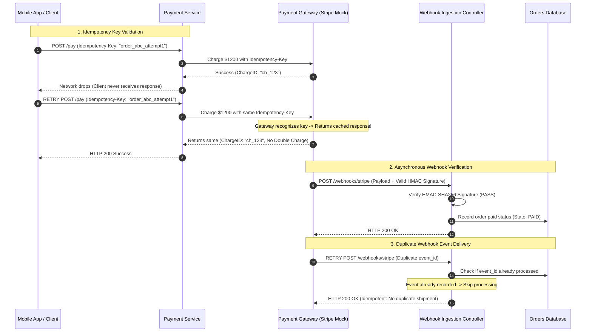

## Fast Revision (10-Second Recall)
- **The Core Rule of Payment Testing:** Never charge a card twice. **Idempotency** is the single most critical capability to test.
- **Idempotency Key Testing:** Send the identical request payload with the exact same `Idempotency-Key` multiple times concurrently; assert that only one financial transaction is executed and identical cached responses are returned.
- **Asynchronous Webhook Testing:** Payments are asynchronous. The HTTP response of `charge()` only initiates the flow; actual settlement arrives via a signed webhook (`payment_intent.succeeded`).
- **Webhook Cryptographic Signatures:** Test that webhooks with valid HMAC signatures (e.g., `Stripe-Signature`) are accepted, while forged or modified signatures return HTTP 400.
- **Webhook Replay Attacks:** Deliver the identical valid webhook event multiple times; assert that orders are not fulfilled twice or duplicate credits awarded.

## The 30-Second Spoken Script
> "Testing payment APIs requires a fundamentally different mindset than standard CRUD testing because financial mutations are high-stakes, asynchronous, and distributed.
>
> We organize payment testing around three non-negotiable vectors:
> First, **Idempotency**: We test that network retries never cause double charges. We send identical payment requests with the same `Idempotency-Key` concurrently. The test verifies that our payment gateway and internal ledger record exactly one charge, returning the same transaction ID for both calls.
> Second, **Webhook Signature Verification**: Modern payment gateways (like Stripe or Adyen) notify systems asynchronously via webhooks. We test our webhook endpoint against valid HMAC SHA-256 signatures, expired timestamps, and tampered payloads to ensure zero unauthorized access.
> Third, **Out-of-Order and Duplicate Webhook Delivery**: Webhooks are guaranteed at-least-once delivery, meaning duplicates and out-of-order deliveries are normal. We assert that processing the same `payment_intent.succeeded` event twice is completely idempotent, and processing a refund before a success event is handled safely.
>
> In CI, we use Stripe Mock and local HMAC signers to execute deterministic payment tests without incurring real financial sandbox rate limits."

## Scenario / Problem Context
An online electronics retailer deployed a new payment checkout system. During a peak flash sale, a customer with a flaky mobile connection clicked "Pay Now." The mobile app sent the payment request, but the cellular connection dropped before receiving the response. The mobile app automatically retried the POST request 2 seconds later.

Because the backend did not implement idempotency keys, the customer's credit card was charged $1,200 twice. Furthermore, the payment gateway fired two webhook events (`charge.succeeded`). The webhook handler credited the customer's account with two laptop orders instead of one, leading to inventory discrepancies and expensive credit card dispute chargeback fees.

The engineering team needs a comprehensive payment test suite that guarantees zero double charges, strictly verifies webhook cryptographic signatures, and handles duplicate asynchronous callbacks.

## Architectural Workflow / Sequence


## Deep-Dive Analysis & Root Causes

### 1. The Two-Generals Problem in Payments
In distributed payment processing, when a client makes a charge request and the network drops before the response arrives, the client cannot know whether the card was charged or not. Idempotency keys solve this: the gateway tracks keys for 24 hours and guarantees that repeated calls with the same key return the original result without executing a second transaction.

### 2. Webhook Signature Security
Attackers can forge HTTP POST requests to your `/api/webhooks` endpoint, faking payment success to obtain free goods. Testing must ensure:
- Requests lacking signature headers return HTTP 400.
- Signatures computed with the wrong secret return HTTP 400.
- Signatures with timestamps older than 5 minutes (replay tolerance) return HTTP 400.
- Only cryptographically valid signatures from the provider secret are accepted.

### 3. Out-of-Order Webhook Events
In distributed systems, a `charge.refunded` webhook might arrive before the initial `charge.succeeded` webhook due to network routing. The state machine must handle out-of-order transitions safely.

## Practical Debugging Commands & Code

### Step 1: Testing Idempotency Against Double Charges
```typescript
// tests/integration/paymentIdempotency.spec.ts
import { describe, it, expect } from 'vitest';
import { PaymentService } from '../../src/services/PaymentService';
import { StripeMockGateway } from '../mocks/StripeMockGateway';

describe('Payment Service Idempotency Enforcement', () => {
  it('prevents duplicate charges when identical idempotency key is submitted concurrently', async () => {
    const mockGateway = new StripeMockGateway();
    const service = new PaymentService(mockGateway);

    const idempotencyKey = 'idem_key_unique_session_9941';
    const chargePayload = {
      amountCents: 5000,
      currency: 'usd',
      customerId: 'cus_123',
    };

    // Fire two identical charge requests simultaneously simulating network retry race
    const [response1, response2] = await Promise.all([
      service.processCharge(chargePayload, idempotencyKey),
      service.processCharge(chargePayload, idempotencyKey),
    ]);

    // 1. Both calls must succeed and return the exact same charge ID
    expect(response1.status).toBe('succeeded');
    expect(response2.status).toBe('succeeded');
    expect(response1.chargeId).toBe(response2.chargeId);

    // 2. Underlying financial gateway must have executed exactly ONE charge!
    expect(mockGateway.getTotalChargesExecuted()).toBe(1);
  });
});
```

### Step 2: Testing Webhook Cryptographic Signature Verification
```typescript
// tests/integration/webhookSecurity.spec.ts
import request from 'supertest';
import crypto from 'node:crypto';
import { app } from '../../src/app';

const WEBHOOK_SECRET = 'whsec_test_secret_key_12345';

function generateStripeSignature(payload: string, secret: string, timestamp?: number): string {
  const t = timestamp || Math.floor(Date.now() / 1000);
  const signature = crypto
    .createHmac('sha256', secret)
    .update(`${t}.${payload}`)
    .digest('hex');
  return `t=${t},v1=${signature}`;
}

describe('Stripe Webhook Cryptographic Verification', () => {
  const eventPayload = JSON.stringify({
    id: 'evt_test_charge_succeeded',
    type: 'payment_intent.succeeded',
    data: { object: { id: 'pi_123', amount: 5000 } },
  });

  it('rejects webhooks with missing signature header with HTTP 400', async () => {
    const res = await request(app)
      .post('/api/webhooks/stripe')
      .set('Content-Type', 'application/json')
      .send(eventPayload);

    expect(res.status).toBe(400);
    expect(res.text).toMatch(/Missing Stripe signature header/);
  });

  it('rejects webhooks with tampered payload or forged signature', async () => {
    const invalidSignature = generateStripeSignature(eventPayload, 'wrong_secret_key');

    const res = await request(app)
      .post('/api/webhooks/stripe')
      .set('Stripe-Signature', invalidSignature)
      .set('Content-Type', 'application/json')
      .send(eventPayload);

    expect(res.status).toBe(400);
    expect(res.text).toMatch(/Webhook signature verification failed/);
  });

  it('accepts validly signed webhooks and processes order fulfillment', async () => {
    const validSignature = generateStripeSignature(eventPayload, WEBHOOK_SECRET);

    const res = await request(app)
      .post('/api/webhooks/stripe')
      .set('Stripe-Signature', validSignature)
      .set('Content-Type', 'application/json')
      .send(eventPayload);

    expect(res.status).toBe(200);
    expect(res.body.received).toBe(true);
  });

  it('handles duplicate webhook delivery idempotently without double processing', async () => {
    const validSignature = generateStripeSignature(eventPayload, WEBHOOK_SECRET);

    // Send the first time
    const res1 = await request(app)
      .post('/api/webhooks/stripe')
      .set('Stripe-Signature', validSignature)
      .send(eventPayload);
    expect(res1.status).toBe(200);

    // Send the identical event a second time (duplicate delivery)
    const res2 = await request(app)
      .post('/api/webhooks/stripe')
      .set('Stripe-Signature', validSignature)
      .send(eventPayload);
    
    // Must acknowledge HTTP 200 cleanly without re-executing business fulfillment
    expect(res2.status).toBe(200);
  });
});
```

### Step 3: Local Stripe Webhook CLI Testing
```bash
# Trigger automated test webhooks directly to local app via official Stripe CLI
stripe listen --forward-to localhost:3000/api/webhooks/stripe

# Trigger specific payment succeeded event
stripe trigger payment_intent.succeeded
```

## Prevention & Senior Best Practices
1. **Always Use Raw Request Bodies for Webhook Verification:** HMAC signature checks require the exact, unmodified byte buffer of the HTTP payload. Never verify signatures against parsed JSON objects, as whitespace variations will invalidate the hash.
2. **Mandate Idempotency Keys on All Mutations:** Every client checkout request must generate a unique client-side UUID idempotency key passed to the gateway.
3. **Record Processed Webhook Event IDs:** Maintain a database table of processed `event_id` records. Wrap event handling in a database transaction that checks for existing IDs before mutating order states.
4. **Enforce Webhook Timestamp Expiration:** Reject any webhook payload whose timestamp is older than 300 seconds to prevent replay attacks.
5. **Never Store Raw Credit Card Data:** Always test that card tokenization occurs entirely on the client side (Stripe Elements / SDK) and that raw PANs never traverse your backend servers, maintaining PCI-DSS compliance.

