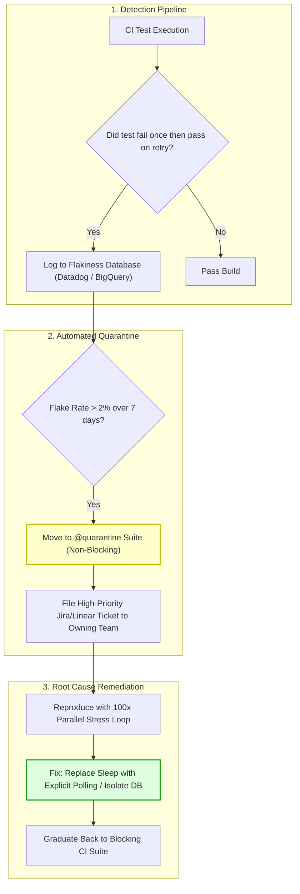

## Fast Revision (10-Second Recall)
- **Flaky Test Definition:** A test that exhibits both passing and failing results across multiple runs on the exact same commit without code modifications.
- **Top 4 Flakiness Culprits:**
  1. *Asynchronous Timing / Race Conditions:* Hardcoded `sleep(1000)` instead of polling conditions or awaiting promises.
  2. *Shared State / Order Dependency:* Tests leaking records into shared test databases or global singleton state.
  3. *Time / Date Jitter:* Hardcoded timestamps or timezone sensitivities (`new Date()` crossing midnight UTC).
  4. *Resource Contention in CI:* CPU throttling or Docker memory starvation causing timeouts under high concurrency.
- **Immediate Action:** **Quarantine immediately.** Never leave flaky tests in PR-blocking suites; auto-quarantine them so developer trust is preserved.
- **Identification Technique:** Stress-test candidates using iterative repeat runners (e.g., run test 100 times concurrently using Jest `--runInBand=false` or Vitest `--repeat 100`).

## The 30-Second Spoken Script
> "A flaky test is a test that fails non-deterministically without any changes to the underlying code. Flaky tests are toxic to engineering culture: they slow down CI pipelines, train developers to ignore build failures, and lead to the bad habit of blindly clicking 'Retry.'
>
> To eliminate flaky tests systematically, we implement a three-phase playbook:
> First, **Detection & Identification**: We run suspicion-tracking scripts in CI that flag tests that failed on first attempt but passed on retry. We reproduce them locally by running the target test 100 times in a loop under artificial CPU throttling.
> Second, **Immediate Quarantine**: Flaky tests are automatically quarantined into a non-blocking test suite so they no longer block production merges, while opening an automated tracking ticket.
> Third, **Root Cause Remediation**: We address the primary root causes: replacing arbitrary sleep timers with condition-based awaiting, isolating database transactions using rollback wrappers, freezing system clocks with fake timers, and eliminating test order dependencies."

## Scenario / Problem Context
An engineering department with 60 developers experiences an average CI failure rate of 34% on master branch pull requests. Developers routinely re-run jobs 2 to 4 times before builds turn green. 

A specific test—`test('should show live notification banner')`—fails 1 out of every 6 runs on GitHub Actions with:
```text
TimeoutError: locator.waitFor: Timeout 5000ms exceeded.
waiting for locator('[data-testid="notification-banner"]') to be visible
```

Upon inspection, the test author wrote:
```typescript
await triggerEvent();
await new Promise(r => setTimeout(r, 800)); // Hoping the animation completes!
expect(await page.locator('[data-testid="notification-banner"]').isVisible()).toBe(true);
```
On local laptops, 800ms was plenty of time. But on a noisy, shared 2-vCPU CI runner, the animation took 1,100ms, causing intermittent test failures.

## Architectural Workflow / Sequence


## Deep-Dive Analysis & Root Causes

### 1. Arbitrary Sleep vs Deterministic Awaiting
The most pervasive cause of flakiness is arbitrary sleep delays (`sleep(2000)`). Test execution time is subject to machine load, memory garbage collection pauses, and network latency. Tests must await explicit condition predicates (e.g., `waitFor(() => expect(...).toBeVisible())`).

### 2. Leaked Global & Database State
Tests that execute in parallel (or in randomized order) often clash over shared state:
- Test A inserts a user with email `admin@test.com`.
- Test B queries `SELECT COUNT(*) FROM users` expecting exactly 0 rows.
- If Test A runs before Test B, Test B fails.
- Fix: Use unique UUIDs for test fixtures (`user-${crypto.randomUUID()}@test.com`) and run tests inside rolled-back database transactions.

### 3. Timezone, Leap Years, and Clock Jitter
Tests doing date calculations:
```typescript
const expiration = new Date();
expiration.setDate(expiration.getDate() + 30);
```
If executed at 23:59:59.999 UTC, or across daylight saving time shifts, assertions comparing expected day offsets fail intermittently.
- Fix: Freeze system clocks using `jest.useFakeTimers()` or `vi.setSystemTime()`.

### 4. Unhandled Promise Rejections & Resource Leaks
Failing to await an asynchronous Promise in an earlier test allows that Promise to resolve or reject in the middle of a subsequent test, crashing it with a confusing stack trace.

## Practical Debugging Commands & Code

### Step 1: Stress-Test and Reproduce Flaky Tests Locally
Use a shell loop to run a suspected test 100 times consecutively until it fails:

```bash
# Bash: Loop 100 times and stop on first failure
for i in {1..100}; do
  echo "Execution Run #$i"
  npx jest src/modules/notifications/banner.spec.ts --bail || break
done

# Vitest: Native repeat command with concurrent threads
npx vitest run src/modules/notifications/banner.spec.ts --repeat 100 --pool=threads
```

### Step 2: Fixing Flakiness (Before vs After)

#### Anti-Pattern: Flaky Timeout & Shared Hardcoded Data
```typescript
// BAD: Flaky test prone to timing delays and collision
it('flaky: sends welcome email to new user', async () => {
  // Hardcoded email collides if previous test run failed to clean up
  const email = 'alex@example.com'; 
  await userService.register({ email, name: 'Alex' });

  // Arbitrary sleep! Fails under high CI CPU load
  await new Promise(resolve => setTimeout(resolve, 1000));

  const sentEmails = emailQueue.getSentEmails();
  expect(sentEmails.some(e => e.to === email)).toBe(true);
});
```

#### Fixed Pattern: Deterministic Polling & Isolated State
```typescript
// GOOD: Robust, deterministic test with isolated UUID and condition polling
import { waitFor } from '@testing-library/react';
import { randomUUID } from 'node:crypto';

it('robust: sends welcome email to new user', async () => {
  // 1. Guaranteed unique identity
  const email = `test-user-${randomUUID()}@example.internal`;

  await userService.register({ email, name: 'Alex' });

  // 2. Deterministic polling: checks every 50ms up to 5000ms max
  await waitFor(
    () => {
      const sentEmails = emailQueue.getSentEmails();
      const target = sentEmails.find(e => e.to === email);
      expect(target).toBeDefined();
      expect(target?.subject).toBe('Welcome to our platform!');
    },
    { timeout: 5000, interval: 50 }
  );
});
```

### Step 3: CI Detection Script for Tracking Retries
```yaml
# In GitHub Actions test step:
- name: Run Tests with Retry Tracking
  run: |
    # Jest with retry reporter logging flakes
    npx jest --reporters="default" --reporters="jest-junit" --maxWorkers=4
  env:
    RECORD_FLAKY_TESTS: "true"
```

## Prevention & Senior Best Practices
1. **Zero Tolerance for Retries as a Solution:** Do not use `jest.retryTimes(3)` or `--retries=2` as a permanent fix. Retries hide real architectural bugs and slow down CI runs.
2. **Quarantine Immediately:** When a test is identified as flaky, immediately tag it with `@quarantine` or move it to `tests/quarantine/`. Block master merges only on trusted tests.
3. **Never Sleep in Tests:** Ban `sleep()`, `setTimeout()`, and `delay()` via ESLint custom rules (`no-restricted-syntax`). Mandate condition-based polling (`waitFor`, `toPass`).
4. **Isolate Database State:** Wrap each integration test in an automated database transaction that performs a `ROLLBACK` during `afterEach()`.
5. **Enforce Test Ownership:** Every test suite must belong to a specific engineering squad via `CODEOWNERS`. If a test turns flaky, the owning squad is automatically assigned the quarantine fix ticket.

