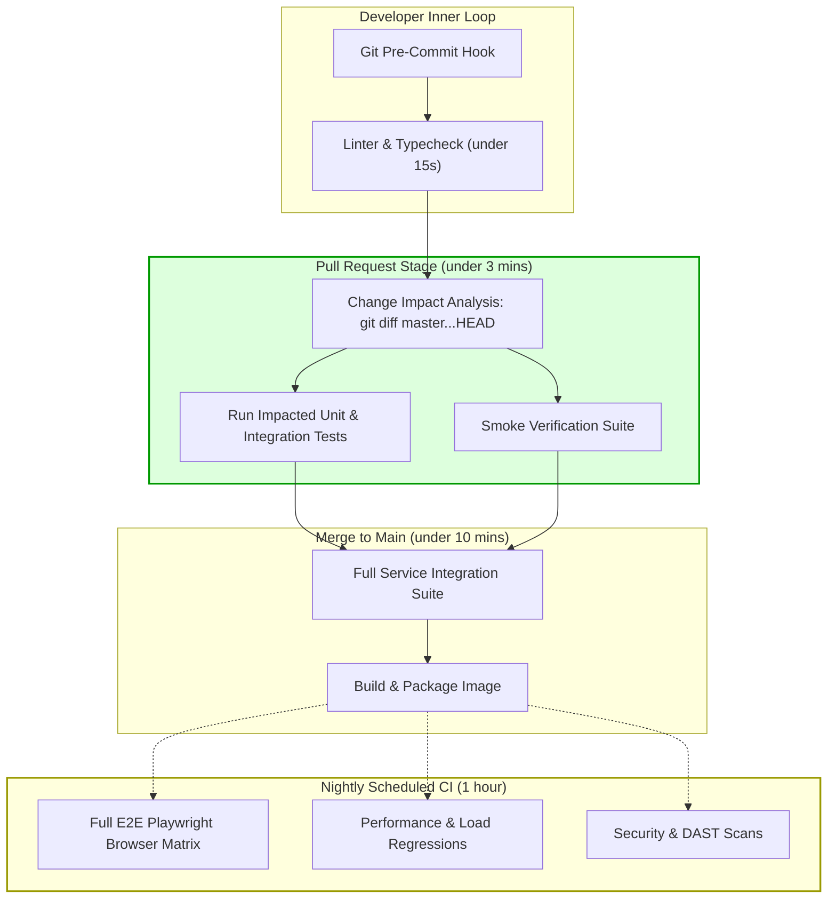

## Fast Revision (10-Second Recall)
- **Primary Objective:** Ensure existing features continue operating correctly after code refactoring, dependency upgrades, or new feature additions.
- **Tiers of Regression:** Tier 1 (Smoke / PR-blocking: under 3 mins), Tier 2 (Core Regression / Merge-to-main: under 10 mins), Tier 3 (Full Nightly Matrix: 1-2 hours).
- **Change Impact Analysis (CIA):** Run only tests relevant to modified code files using Git diff dependency graphs (e.g., Jest `--changedSince`, Nx/Turborepo affected commands).
- **Defect-Driven Regression:** Every production bug ticket must produce a failing regression test before code fixes are merged.
- **Suite Rot Prevention:** Periodically prune obsolete, duplicate, or unmaintained regression tests to preserve fast developer inner-loop velocity.

## The 30-Second Spoken Script
> "Implementing effective regression testing requires balancing thorough safety coverage with high developer velocity. Running every single test ever written on every pull request quickly leads to 45-minute CI queues and developer fatigue.
>
> In senior engineering teams, we solve this through **tiered regression suites** and **Change Impact Analysis**. We establish three distinct tiers:
> First, a fast **Commit / PR suite** running unit and impacted integration tests in under 3 minutes using tools like Jest `--changedSince` or Turborepo affected graph execution.
> Second, a **Pre-Merge Regression suite** that executes all core integration tests and critical API workflows in under 10 minutes.
> Third, an extensive **Nightly Regression Matrix** that runs full browser E2E journeys, multi-browser tests, performance benchmarks, and edge-case matrix variations.
>
> Crucially, our process mandates a strict **Defect-Driven workflow**: whenever a production bug is reported, the developer must first write a failing test that reproduces the defect, commit it, and verify that the subsequent fix turns the test green permanently."

## Scenario / Problem Context
A high-growth fintech application has accumulated 8,500 tests over 4 years. The monolithic CI build takes 58 minutes to run on GitHub Actions. Because developers wait an hour for feedback on every pull request, they bundle massive, risky changes into single commits.

Furthermore, despite the 58-minute test suite, a critical bug slipped into production: updating a utility function in the common payment calculation library broke recurring subscription billings. The test suite for recurring subscriptions had been manually disabled months ago because it was deemed "too slow."

The VP of Engineering mandates a complete overhaul of the regression strategy to deliver under 5-minute PR feedback while guaranteeing zero payment calculation regressions.

## Architectural Workflow / Sequence


## Deep-Dive Analysis & Root Causes

### 1. The Full-Suite Anti-Pattern
Running 100% of tests on every single typo fix or documentation change wastes massive compute resources and paralyzes engineering teams. As codebases grow, linear test growth causes exponential pipeline slowdowns unless test selection algorithms are deployed.

### 2. Change Impact Analysis (CIA)
Modern mono-repos and microservices leverage dependency graphs. If a PR modifies `src/auth/tokenService.ts`:
- Auth unit tests must run.
- API routes importing `tokenService` must run.
- Unrelated domains (e.g., `src/billing/invoicePdfGenerator.ts`) are safely bypassed during the PR gate.

### 3. Defect-Driven Regression Loop
When bugs occur, developers often patch code without adding regression tests, leading to recurrence regressions ("whack-a-mole" bugs). A formal regression framework requires:
1. Replicate bug with an automated test (State: FAILED).
2. Submit PR with bug reproducer test + fix.
3. CI asserts test transitions to PASSED.
4. Test remains permanently in the core regression tier.

## Practical Debugging Commands & Code

### Step 1: Automated Change Impact Selection via Jest / Git
Configure CI scripts to execute only tests affected by the current pull request branch:

```bash
# In GitHub Actions PR workflow: Run only tests related to changed files against main
npx jest --changedSince=origin/main --maxWorkers=4 --bail
```

For Monorepos (Turborepo / Nx):
```bash
# Turborepo: Execute tests only for packages that changed relative to origin/main
npx turbo run test --filter=...[origin/main]
```

### Step 2: Implementing a Defect-Driven Regression Test
When fixing an invoice rounding bug (Ticket: FIN-4029), capture the exact regression vector:

```typescript
// tests/regression/fin-4029-vat-rounding.regression.spec.ts
import { calculateInvoiceTotals } from '../../src/services/billingCalculator';

describe('Regression FIN-4029: Floating point rounding error in multi-currency VAT calculation', () => {
  it('correctly rounds sub-cent tax fractions without losing 1 cent on $19.99 items', () => {
    // Exact customer payload that caused production invoice mismatch in July 2026
    const lineItems = [
      { unitPriceCents: 1999, quantity: 1, taxRate: 0.19 }, // $19.99 * 19% = $3.7981 -> $3.80
      { unitPriceCents: 499, quantity: 2, taxRate: 0.19 },  // $9.98 * 19% = $1.8962 -> $1.90
    ];

    const result = calculateInvoiceTotals(lineItems);

    // Old code returned 569 cents ($5.69) due to Math.floor truncation
    // Fixed code must properly bankers-round to 570 cents ($5.70)
    expect(result.taxTotalCents).toBe(570);
    expect(result.grandTotalCents).toBe(3568);
  });
});
```

### Step 3: GitHub Actions Workflow for Tiered Regression Testing
```yaml
name: CI Regression Pipeline

on:
  pull_request:
    branches: [main]
  schedule:
    - cron: '0 2 * * *' # Nightly at 2:00 AM UTC

jobs:
  # Tier 1: Fast PR Gate (under 3 minutes)
  tier1-pr-regression:
    if: github.event_name == 'pull_request'
    runs-on: ubuntu-latest
    steps:
      - uses: actions/checkout@v4
        with:
          fetch-depth: 0 # Required for git diff comparison

      - uses: actions/setup-node@v4
        with:
          node-version: 20
          cache: 'npm'

      - run: npm ci
      - name: Run Impacted Tests Only
        run: npx jest --changedSince=origin/main --coverage=false

  # Tier 3: Nightly Full Regression Matrix (1 hour)
  tier3-nightly-full-regression:
    if: github.event_name == 'schedule'
    runs-on: ubuntu-latest
    steps:
      - uses: actions/checkout@v4
      - uses: actions/setup-node@v4
        with:
          node-version: 20
      - run: npm ci
      - name: Run Complete Test Suite
        run: npm run test:all
      - name: Run Full Playwright E2E Matrix
        run: npx playwright test --config=playwright.matrix.config.ts
```

## Prevention & Senior Best Practices
1. **Never Let PR CI Exceed 5 Minutes:** If PR test execution passes 5 minutes, engineers stop running tests locally and context-switch. Aggressively parallelize or tier slow suites.
2. **Quarantine Rather Than Delete:** When a test becomes flaky or slow, move it to a `@quarantine` tag that runs out-of-band in nightly runs, with an owner and expiration ticket attached.
3. **Automate Test Suite Pruning:** Audit tests quarterly. If a test has not caught a bug in 2 years and tests redundant internal states covered by higher-fidelity integration tests, delete it.
4. **Contract Tests Over E2E Regressions:** Replace brittle end-to-end integration tests with consumer-driven contract tests (Pact), which validate inter-service compatibility without spinning up whole clusters.
5. **Enforce Reproducing Regressions in Pull Requests:** Reject any bug-fix PR that does not include an accompanying regression test asserting the fix.

