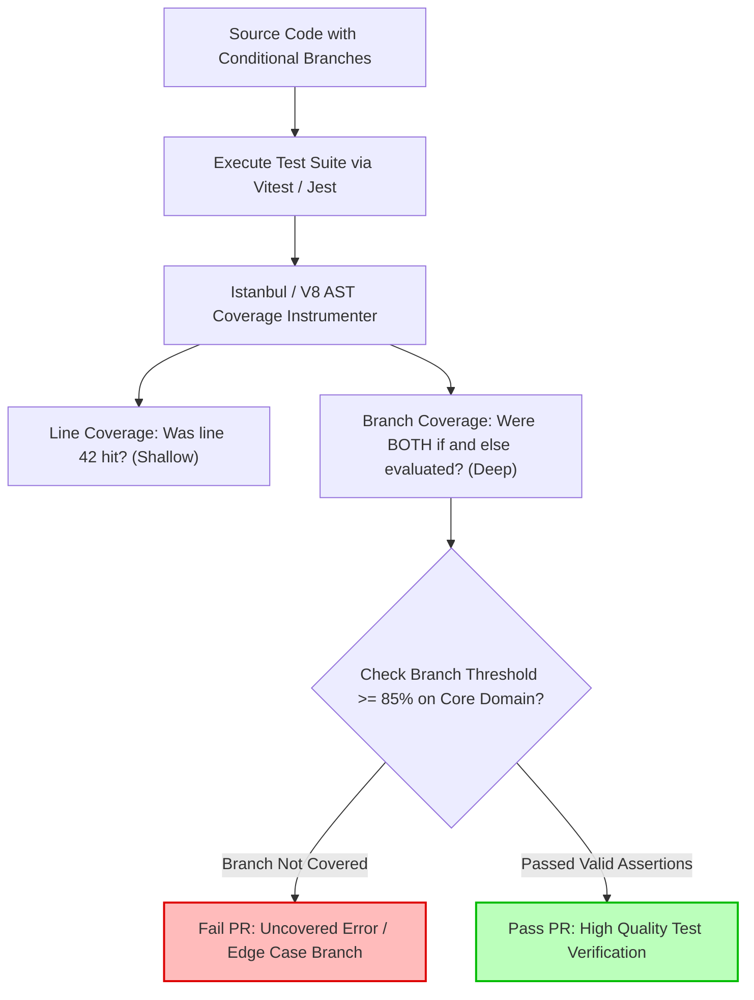

## Fast Revision (10-Second Recall)
- **Core Coverage Types:**
  - *Line / Statement Coverage:* Percentage of executable lines hit by tests. (Easily gamed; gives false sense of security).
  - *Branch / Decision Coverage:* Percentage of conditional branches (`if/else`, switch, ternary, boolean short-circuits) evaluated to both true and false. (Highest architectural value).
  - *Function Coverage:* Percentage of declared functions invoked at least once.
  - *Path Coverage:* All possible execution paths through a function (exponential complexity; rarely practical).
- **Goodhart's Law:** *"When a measure becomes a target, it ceases to be a good measure."* Mandating 100% coverage leads to assertion-free vanity tests.
- **Pragmatic Target:** Enforce 80% to 85% branch coverage on core business domain logic; exclude generated code, DTOs, migrations, and boilerplate configurations.

## The 30-Second Spoken Script
> "Code coverage measures which lines, statements, and conditional branches are executed during automated test runs. However, as senior engineers, we emphasize that **high code coverage is a measure of what code was touched, not whether the code works correctly.**
>
> A test suite can achieve 100% line coverage with zero assertions simply by executing methods and ignoring the output. Therefore, the metric that truly matters is **Branch Coverage**—verifying that every `if`, `else`, error catch block, and ternary branch evaluates to both truthy and falsy states.
>
> In our engineering pipelines, we establish pragmatic coverage policies: we avoid dogmatic 100% targets. Instead, we enforce a strict 85% branch coverage gate on domain models, financial calculation logic, and security authorization guards. Simultaneously, we exclude database migrations, framework boilerplate, and auto-generated API clients from coverage calculations to prevent developers from writing wasteful vanity tests."

## Scenario / Problem Context
A banking app had a strict CI policy: *"All PRs must maintain 100% line coverage or the build fails."*

An engineer submitted a PR updating interest calculation logic. To satisfy the 100% coverage rule for an edge-case error path, the engineer wrote the following test:
```typescript
it('covers error handling branch', async () => {
  try {
    await calculateCompoundInterest(-500, 0.05, 12);
  } catch (e) {
    // No assertions! Just calling it to turn the line green in Istanbul report.
  }
});
```

A month later, a customer passed a negative principal. The error handler was indeed executed, but inside the catch block, a logging bug caused an uncaught exception that crashed the Node.js process. The line coverage was 100%, but testing verification was 0%.

The engineering organization needs a coverage strategy that measures genuine test effectiveness rather than encouraging gamified vanity metrics.

## Architectural Workflow / Sequence


## Deep-Dive Analysis & Root Causes

### 1. Line Coverage vs Branch Coverage

Consider this function:
```typescript
function processDiscount(user: User, orderTotal: number): number {
  let discount = 0;
  if (user.isVip && orderTotal > 100) {
    discount = 20;
  }
  return orderTotal - discount;
}
```
If a test passes `user.isVip = true` and `orderTotal = 200`:
- **Line Coverage = 100%:** Every line in the function was executed.
- **Branch Coverage = 50%:** The compound condition has four permutations (`T/T`, `T/F`, `F/T`, `F/F`). The branch where a regular user places an order over $100 was never tested! If `isVip` throws a null reference error for guest users, the 100% line coverage test suite fails to detect it.

### 2. Mutation Testing: The True Litmus Test
To test the quality of your tests, use **Mutation Testing** (e.g., Stryker). Mutation testing deliberately alters your source code (changing `>` to `<`, swapping `+` for `-`, or deleting function calls) and runs your test suite against the mutant:
- If your tests FAIL: The mutant is **killed** (High quality tests).
- If your tests PASS: The mutant **survived** (Flawed tests with weak assertions).

### 3. Coverage Exclusions & Scoping
Not all code deserves equal test coverage:
- **Core Domain Logic / Math / Auth:** Require 90%+ branch coverage.
- **Controllers / Routing Glue:** Require 70% integration coverage.
- **Auto-generated code (GraphQL schemas, ORM migrations, DTO types):** Exclude 100% from coverage reports.

## Practical Debugging Commands & Code

### Step 1: Configuring Jest / Vitest for Strict Branch Coverage
Configure coverage thresholds in `vitest.config.ts` or `jest.config.js`:

```typescript
// vitest.config.ts
import { defineConfig } from 'vitest/config';

export default defineConfig({
  test: {
    coverage: {
      provider: 'v8', // Native V8 engine coverage (blazing fast)
      reporter: ['text', 'json-summary', 'html'],
      all: true,
      include: ['src/domain/**/*.ts', 'src/services/**/*.ts'],
      exclude: [
        'src/**/*.dto.ts',
        'src/migrations/**',
        'src/config/**',
        'src/**/*.interface.ts',
      ],
      thresholds: {
        // Enforce meaningful branch coverage, not just line vanity
        branches: 85,
        functions: 80,
        lines: 80,
        statements: 80,
      },
    },
  },
});
```

### Step 2: Running Coverage Reports via CLI
```bash
# Generate terminal summary and detailed HTML report
npx vitest run --coverage

# View uncovered lines in terminal
# Output displays: % Stmts | % Branch | % Funcs | % Lines | Uncovered Line #s
```

### Step 3: Automated PR Diff Coverage (Codecov / Coveralls)
Instead of requiring 85% total repository coverage (which penalizes engineers refactoring legacy code), enforce **PR Patch Coverage**:

```yaml
# codecov.yml: Require that newly introduced code in this PR has >= 90% coverage
coverage:
  status:
    project:
      default:
        target: auto
        threshold: 1% # Allow slight project-wide fluctuation
    patch:
      default:
        target: 90% # 90% of newly added lines/branches must be tested
        threshold: 0%
```

### Step 4: Mutation Testing with Stryker
Run mutation testing to reveal useless tests that have high coverage but no real assertions:

```bash
# Run Stryker to inject mutations into the calculation service
npx stryker run --mutate "src/domain/interestCalculator.ts"
```

## Prevention & Senior Best Practices
1. **Prioritize Branch Over Line Coverage:** Configure CI to fail on branch coverage regressions rather than line coverage.
2. **Measure Patch Coverage in PRs:** Require 90% coverage on newly written code in pull requests, avoiding friction over untouched legacy files.
3. **Ban Assertion-Free Tests:** Configure ESLint rules (`jest/expect-expect`) to fail any test that does not contain explicit assertion statements (`expect(...)`).
4. **Ruthlessly Exclude Boilerplate:** Add configuration files, database migration scripts, and auto-generated TypeScript types to coverage exclusion lists.
5. **Periodic Mutation Testing:** Run Stryker mutation tests in nightly builds on core financial, security, and algorithmic modules to identify assertion gaps.

