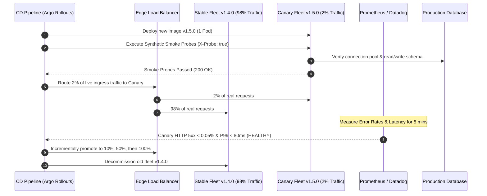

## Fast Revision (10-Second Recall)
- **Core Goal:** Validate that a newly built container or binary runs reliably in production infrastructure before exposing 100% of real users to it.
- **Canary Deployments:** Route a tiny fraction (1% to 5%) of real production traffic to the new version (Canary) and compare latency/error metrics against the control baseline.
- **Blue-Green Deployments:** Spin up the identical new release (Green) in parallel to current (Blue). Run automated synthetic end-to-end smoke tests against Green before flipping the load balancer switch.
- **Dark Launching & Feature Flags:** Deploy code to production with features disabled behind dynamic flags (LaunchDarkly, Unleash), verifying backend stability without exposing UI changes.
- **Synthetic Transactions:** Fire automated headless test requests with specific headers (`X-Test-Probe: true`) through the live gateway to verify zero-downtime database migrations.

## The 30-Second Spoken Script
> "Testing a deployment before releasing it requires shifting from static staging tests to production canary verification. Staging environments frequently suffer from configuration drift, outdated data volumes, and missing third-party webhook integrations.
>
> In high-reliability engineering, we deploy using **Canary** or **Blue-Green** strategies. With Blue-Green, the new version is deployed to an isolated 'Green' environment that shares production datastores. Before pointing the router to Green, automated smoke suites and synthetic probes exercise critical paths—such as authentication, payment gateway handshakes, and health endpoints.
>
> With Canary deployments, we route 2% of live traffic to the new pod replica set. Automated analysis monitors HTTP 5xx error rates, P99 latency, and CPU memory leak slopes against the stable 98% baseline. If the canary error rate exceeds the baseline by more than 0.1%, the deployment rolls back automatically in seconds, before real customers experience an outage."

## Scenario / Problem Context
A media streaming service deploys an update on Friday afternoon after staging verification passed with flying colors. However, upon routing 100% of production traffic to the new build:
1. Production uses a Redis Cluster with TLS, whereas Staging used a standalone unencrypted Redis instance. The production pods crashed in an unhandled SSL handshake loop.
2. The staging database had 1,000 users; production had 45,000,000 users. A missing index in a startup cache-warming query locked the production database for 4 minutes, causing a complete system outage.

The post-mortem concluded that staging cannot replicate production scale, network topology, or secret management. The organization requires a rigorous pre-release verification architecture directly on production infrastructure.

## Architectural Workflow / Sequence


## Deep-Dive Analysis & Root Causes

### 1. The Staging Illusion
Staging environments fail to catch production bugs because:
- **Data Scale:** Queries that run in 2ms on 500 rows take 12 seconds on 20 million rows.
- **Topology Divergence:** Staging often uses single-node clusters without cross-AZ network latency or read replicas.
- **Third-Party Integrations:** Payment gateways (Stripe, PayPal) use sandbox mock modes that do not enforce real production KYC or banking fraud filters.

### 2. Blue-Green vs Canary Deployment Verification
- **Blue-Green:** Best for non-breaking API changes where instant full switchover is needed. You test the Green environment thoroughly via internal DNS before flipping the router. Rollback is instant (switch router back to Blue).
- **Canary:** Best for high-traffic distributed services. Exposes only 1% to 5% of users to risk. Catches subtle memory leaks, connection pool starvation, and unhandled edge-case payloads under real traffic.

### 3. Automated Canary Analysis (ACA)
Rather than humans staring at Grafana dashboards, automated release operators (such as Argo Rollouts or Spinnaker Kayenta) continuously calculate statistical divergence (Mann-Whitney U test) between Canary and Baseline metrics:
- HTTP 5xx error rate ratio.
- P95 and P99 latency deltas.
- Pod container crash restarts (`OOMKilled`).

## Practical Debugging Commands & Code

### Step 1: Automated Pre-Release Synthetic Smoke Probe Script
Run this script against the unexposed Green/Canary deployment before switching ingress:

```bash
#!/usr/bin/env bash
# pre-release-smoke.sh: Runs synthetic verification against target deployment internal IP
set -euo pipefail

TARGET_HOST="${1:-http://canary-internal.service.internal:8080}"
echo "Running Pre-Release Verification against ${TARGET_HOST}..."

# 1. Health & Liveness Probe
STATUS=$(curl -s -o /dev/null -w "%{http_code}" "${TARGET_HOST}/healthz")
if [ "$STATUS" -ne 200 ]; then
  echo "FAIL: Health check returned HTTP $STATUS"
  exit 1
fi
echo "PASS: Health check is 200 OK"

# 2. Database & Redis Connectivity Probe
DEPS_STATUS=$(curl -s -o /dev/null -w "%{http_code}" "${TARGET_HOST}/readyz")
if [ "$DEPS_STATUS" -ne 200 ]; then
  echo "FAIL: Readiness probe dependencies unhealthy (HTTP $DEPS_STATUS)"
  exit 1
fi
echo "PASS: Dependencies (DB/Cache) verified"

# 3. Synthetic Critical Path Test (With Test-Probe Bypass Header)
ORDER_RESP=$(curl -s -X POST "${TARGET_HOST}/api/v1/orders/synthetic-check" \
  -H "Content-Type: application/json" \
  -H "X-Synthetic-Probe: true" \
  -d '{"testSessionId": "probe_check_123"}')

if echo "$ORDER_RESP" | grep -q '"status":"VERIFIED"'; then
  echo "PASS: Synthetic transactional workflow executed successfully"
else
  echo "FAIL: Synthetic transaction failed: $ORDER_RESP"
  exit 1
fi

echo "ALL PRE-RELEASE TESTS PASSED. Ready for traffic promotion."
```

### Step 2: Kubernetes Argo Rollouts Canary Specification
Declaratively configure automated metric validation before release promotion:

```yaml
apiVersion: argoproj.io/v1alpha1
kind: Rollout
metadata:
  name: order-service-rollout
spec:
  replicas: 10
  strategy:
    canary:
      analysis:
        templates:
          - templateName: success-rate-metric
        args:
          - name: service-name
            value: order-service-canary
      steps:
        # Step 1: Deploy Canary with 5% traffic
        - setWeight: 5
        # Step 2: Pause 5 minutes for automated Prometheus metrics collection
        - pause: { duration: 5m }
        # Step 3: Promote to 25% traffic
        - setWeight: 25
        - pause: { duration: 10m }
        # Step 4: Promote to 100% traffic
        - setWeight: 100
---
apiVersion: argoproj.io/v1alpha1
kind: AnalysisTemplate
metadata:
  name: success-rate-metric
spec:
  metrics:
    - name: success-rate
      interval: 30s
      successCondition: result[0] >= 0.999 # 99.9% success rate required
      failureLimit: 2
      provider:
        prometheus:
          address: http://prometheus.monitoring:9090
          query: |
            sum(rate(http_requests_total{status=~"2..",app="order-service-canary"}[1m])) 
            / 
            sum(rate(http_requests_total{app="order-service-canary"}[1m]))
```

## Prevention & Senior Best Practices
1. **Never Deploy Directly to 100%:** Eliminate Big-Bang releases. Mandate either Canary or Blue-Green release pipelines for all production services.
2. **Tag Synthetic Traffic:** Ensure synthetic probes contain `X-Synthetic-Probe: true` headers so telemetry filters out test metrics from real business revenue dashboards.
3. **Automate Instant Aborts:** Configure CD operators to immediately roll back when canary pods experience restart spikes (`CrashLoopBackOff`) or error threshold violations.
4. **Dark Launch with Feature Flags:** Decouple code deployment from feature release. Deploy dormant code first; verify cluster resource consumption; then toggle feature flags on for beta users.
5. **Practice Chaos in Pre-Release:** Use Chaos Mesh or Litmus to inject network delays or pod restarts during the canary evaluation window to ensure graceful degradation.

