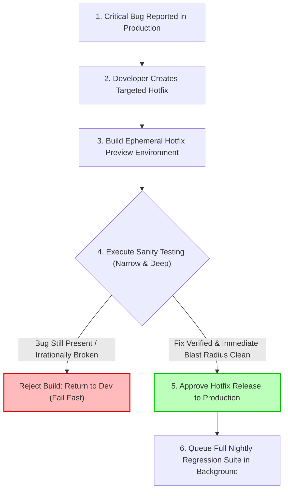

## Fast Revision (10-Second Recall)
- **Core Concept:** A subset of regression testing conducted after receiving a minor hotfix or specific code change to verify that the reported defect is truly resolved and immediate related workflows behave rationally.
- **Depth vs Breadth:** Unlike smoke testing (which is broad and shallow across the whole app), sanity testing is **narrow and deep** around the altered component.
- **Unscripted & Pragmatic:** Often performed quickly by engineers or QA to validate bug fixes before running larger automated regressions or pushing an urgent hotfix.
- **Decision Gate:** If sanity testing fails, the build is rejected immediately as "insane"; it is wasteful to run expensive end-to-end regression tests on an unresolved fix.
- **Typical Use Case:** Verifying an emergency hotfix in production or testing a cherry-picked patch on a release candidate branch.

## The 30-Second Spoken Script
> "Sanity testing is a focused, deep verification performed after a specific bug fix or minor enhancement has been deployed to a build. While smoke testing is broad and shallow—confirming the whole system can boot—sanity testing is **narrow and deep**, focusing exclusively on the altered component and its immediate blast radius.
>
> For example, if an engineer fixes a defect where coupon codes containing hyphen characters failed during checkout, a sanity test exercises that exact coupon redemption with various hyphenated codes, ensures the discount is subtracted accurately from the order total, and checks that error messaging handles invalid hyphens gracefully.
>
> Sanity testing proves that the proposed fix actually works as intended and that the developer did not introduce obvious side-effects into the immediate module. Once the sanity test passes, the build proceeds to broader automated regression and deployment."

## Scenario / Problem Context
During a critical Black Friday sales event, users reported that clicking "Apply Gift Card" threw an unhandled JavaScript TypeError: `Cannot read properties of undefined (reading 'balance')`.

An on-call engineer quickly pushed a hotfix commit to the hotfix branch. With millions of dollars of transactions at stake every hour, the engineering team cannot afford to wait 45 minutes for a full multi-browser regression matrix to run.

Instead, the team deploys the hotfix build to a staging canary. The QA engineer and release lead execute a targeted **Sanity Test Suite**:
1. Enter an active gift card with $50 balance -> Verify balance displays and applies to total.
2. Enter an empty gift card ($0 balance) -> Verify friendly error message.
3. Remove gift card -> Verify total reverts cleanly.

The sanity test succeeds in 3 minutes. The team releases the hotfix to production immediately, saving the sales event while leaving full regression testing for the next scheduled deployment window.

## Architectural Workflow / Sequence


## Deep-Dive Analysis & Root Causes

### 1. Conceptual Distinction Matrix

| Metric | Smoke Testing | Sanity Testing | Regression Testing |
| :--- | :--- | :--- | :--- |
| **Origin / Metaphor** | Electronics / Plumbing smoke check | "Is the developer's change sane?" | "Has anything regressed?" |
| **Testing Scope** | Entire application (Shallow) | Specific module / bug area (Deep) | Entire application (Exhaustive) |
| **Execution Trigger** | Initial build creation / deploy | Targeted bug fix or patch deployment | Pre-release merge / Scheduled CI |
| **Subsetting** | Subset of Acceptance Tests | Subset of Regression Tests | Full test suite |
| **Primary Goal** | Assess general build stability | Verify bug fix & rational behavior | Ensure nothing else broke |
| **Typical Duration** | Under 1 minute | Under 3 - 5 minutes | 15 - 60+ minutes |

### 2. When to Apply Sanity Testing
- **Production Hotfixes:** When time to resolution is paramount and running a multi-hour test cycle would extend customer outage downtime.
- **Sprint End Bug Verification:** When QA verifies tickets in Jira/Linear before marking them "Closed."
- **Minor Dependency Patches:** When upgrading a single micro-library (e.g., updating `validator` from 13.9.0 to 13.9.1) and sanity-checking string validation behavior.

### 3. Common Sanity Pitfalls
- **Overconfidence:** Assuming that because the sanity test passed, the fix could not have broken anything elsewhere in the system. Full regression must still follow in the background.
- **Testing Only the Happy Path:** Only checking that the bug is fixed without checking how the fix handles boundary inputs (e.g., empty string, negative balance).
- **Scope Creep:** Turning a 3-minute sanity check into a 40-minute ad-hoc exploratory testing session.

## Practical Debugging Commands & Code

### Step 1: Running Scoped Sanity Test Suites via Test Runners
Organize targeted tests using Vitest / Jest tags or path filters to execute sanity runs in under 30 seconds:

```bash
# Run only sanity tests tagged for billing hotfixes
npx vitest run --testNamePattern="Sanity" src/modules/billing/

# Target specifically the affected service test file directly
npx jest src/modules/billing/giftCardService.spec.ts --runInBand
```

### Step 2: Implementation of a Targeted Sanity Test Spec
A sample test specifically validating the bug fix and immediate adjacent edge cases:

```typescript
// src/modules/billing/giftCardService.sanity.spec.ts
import { describe, it, expect, beforeEach } from 'vitest';
import { GiftCardService } from './GiftCardService';
import { MockGiftCardGateway } from './mocks/MockGiftCardGateway';

describe('Sanity Suite: Hotfix HOTFIX-1082 (Gift Card Null Pointer)', () => {
  let service: GiftCardService;
  let mockGateway: MockGiftCardGateway;

  beforeEach(() => {
    mockGateway = new MockGiftCardGateway();
    service = new GiftCardService(mockGateway);
  });

  it('Sanity: Successfully applies valid gift card with positive balance', async () => {
    mockGateway.stubCard('GC-VALID-50', { balanceCents: 5000, active: true });

    const result = await service.applyCardToCart({
      cartTotalCents: 10000,
      giftCardCode: 'GC-VALID-50',
    });

    expect(result.appliedAmountCents).toBe(5000);
    expect(result.remainingCartTotalCents).toBe(5000);
    expect(result.isSuccess).toBe(true);
  });

  it('Sanity: Handles card with empty/zero balance without crashing with TypeError', async () => {
    mockGateway.stubCard('GC-ZERO-00', { balanceCents: 0, active: true });

    const result = await service.applyCardToCart({
      cartTotalCents: 10000,
      giftCardCode: 'GC-ZERO-00',
    });

    expect(result.appliedAmountCents).toBe(0);
    expect(result.errorMessage).toBe('Gift card balance is depleted.');
    expect(result.isSuccess).toBe(false);
  });

  it('Sanity: Gracefully handles null/undefined gateway responses without uncaught exception', async () => {
    // Simulates the exact crash scenario from production
    mockGateway.stubCard('GC-NOTFOUND', null);

    const result = await service.applyCardToCart({
      cartTotalCents: 10000,
      giftCardCode: 'GC-NOTFOUND',
    });

    expect(result.isSuccess).toBe(false);
    expect(result.errorMessage).toBe('Invalid or unactivated gift card.');
  });
});
```

### Step 3: Hotfix CI Fast-Path Script
```yaml
# GitHub Actions Fast-Path for Emergency Hotfixes
name: Hotfix Emergency Fast-Track
on:
  push:
    branches: ['hotfix/**']

jobs:
  fast-track-sanity:
    runs-on: ubuntu-latest
    steps:
      - uses: actions/checkout@v4
      - uses: actions/setup-node@v4
        with:
          node-version: 20
      - run: npm ci
      - name: Execute Scoped Sanity Tests
        run: npm run test:sanity
      - name: Build and Deploy to Hotfix Preview Environment
        run: |
          docker build -t app:hotfix-${{ github.sha }} .
          echo "Hotfix ready for manual & automated sanity verification."
```

## Prevention & Senior Best Practices
1. **Define Strict Sanity Scope:** Keep sanity testing focused strictly on the fix and its immediate blast radius. Do not drift into unrelated exploratory testing.
2. **Automate Sanity Suites:** Tag tests with `@sanity` so that emergency hotfix pipelines can run them in under 2 minutes without human delays.
3. **Never Skip Full Regression Post-Hotfix:** After pushing an urgent hotfix based on successful sanity verification, trigger the full regression pipeline in the background to ensure no hidden regressions were introduced.
4. **Document Sanity Checklists:** For legacy or high-risk services, maintain a 5-bullet sanity checklist in repository root (`HOTFIX_SANITY.md`) for on-call engineers.
5. **Pair QA with Developers on Hotfixes:** For critical production patches, have the engineer who authored the fix pair directly with QA to run sanity tests together on a preview environment.

