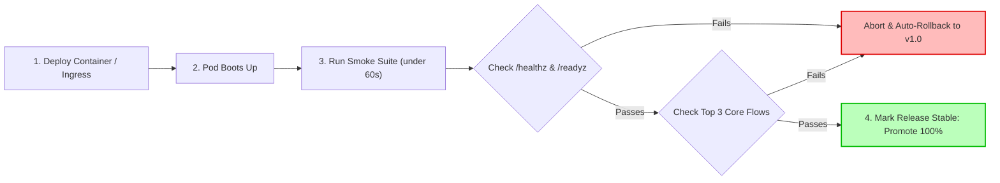

## Fast Revision (10-Second Recall)
- **Origin & Core Purpose:** Derived from hardware plumbing/electronics ("if it emits smoke when plugged in, turn it off immediately"). A minimal set of non-exhaustive tests verifying that the build is stable enough for further testing or traffic.
- **Execution Window:** Runs in under 60 to 90 seconds immediately following a deployment or container start.
- **Key Characteristics:** Broad but shallow. Does not test edge cases, parameter validation, or corner bugs. Tests whether the application boots, connects to dependencies, and fulfills critical happy-path routes.
- **Fail Fast:** If smoke tests fail, the deployment is rejected immediately; deep regression suites are aborted to save CI compute and engineer time.
- **Production Safety:** Smoke tests must be idempotent and non-destructive so they can safely run directly against live production endpoints.

## The 30-Second Spoken Script
> "Smoke testing is a rapid, non-exhaustive verification suite that runs immediately after a fresh deployment to confirm that the application's most critical subsystems are alive and operational. The term comes from hardware engineering: when you plug in a circuit board, if it emits smoke, you immediately cut power before doing any detailed measurements.
>
> In software delivery, a smoke test suite answers one fundamental question: **'Is this build fundamentally viable, or is it broken on arrival?'**
>
> Smoke tests are intentionally broad and shallow. Instead of checking edge cases or invalid inputs, a smoke test validates that the HTTP server is listening, database connection pools are active, Redis caches respond, and the primary revenue workflow—such as landing page loading, user authentication, and fetching a sample product—succeeds with HTTP 200.
>
> In our CI/CD pipelines, smoke tests execute in under 60 seconds post-deploy. If any smoke test fails, the deployment immediately triggers an automated rollback, saving team time and protecting downstream users."

## Scenario / Problem Context
A team released a microservice update containing an accidental syntax error in a configuration file: `DATABASE_PORT: "fifty-four-thirty-two"` instead of `5432`.

Because the team had no post-deployment smoke test, the continuous deployment pipeline declared the deployment "Complete" simply because the Docker image finished pushing to the container registry. Meanwhile, the Kubernetes pods entered a `CrashLoopBackOff` state. Users attempting to access the service received HTTP 502 Bad Gateway errors for 25 minutes before an on-call engineer was paged by an alert.

Had a 30-second automated smoke test run immediately post-deployment, the pipeline would have caught the startup crash instantly, aborted the rollout, and triggered an automatic rollback to the previous working revision with zero human intervention.

## Architectural Workflow / Sequence


## Deep-Dive Analysis & Root Causes

### 1. Smoke Testing vs Regression Testing vs Sanity Testing

| Dimension | Smoke Testing | Sanity Testing | Regression Testing |
| :--- | :--- | :--- | :--- |
| **Focus** | Breadth over depth (Core viability) | Focused depth on specific fixed feature | Exhaustive depth across entire system |
| **When Executed** | Right after fresh build / deployment | After a specific bug fix or hotfix build | Prior to major release / Nightly CI |
| **Execution Speed** | Under 1 to 2 minutes | 2 to 5 minutes | 15 minutes to hours |
| **Failure Implication** | Build is fundamentally broken; reject instantly | Specific bug fix failed; reject patch | Refactoring broke unrelated feature |
| **Conducted By** | Automated CD pipeline scripts | Automated tests or QA engineers | Automated CI/CD pipeline |

### 2. What Belongs in a Smoke Test?
- **Application Startup:** Did the process boot without throwing runtime syntax/import errors?
- **Critical Dependency Probes:** Can the app query the primary database, read from Redis, and publish a heartbeat message to Kafka?
- **Health Probes:** Are `/healthz` (liveness) and `/readyz` (readiness) returning HTTP 200?
- **Top 2-3 User Journeys:**
  - Can an anonymous visitor fetch the home page or catalog?
  - Can a test user obtain an auth session token?
  - Can the search index return at least 1 record?

### 3. What NEVER Belongs in a Smoke Test?
- Boundary validation tests (e.g., verifying that a 256-character password returns an error).
- Edge-case financial calculations (e.g., VAT rounding for multi-currency carts).
- Slow, heavyweight batch operations (e.g., generating 100-page PDF reports).
- Destructive state mutations that cannot be easily purged.

## Practical Debugging Commands & Code

### Step 1: Lightweight Automated Smoke Test Suite in Vitest / TypeScript
Create a fast, standalone smoke test file that runs against any target environment URL via environment variable:

```typescript
// tests/smoke/production-smoke.spec.ts
import { describe, it, expect } from 'vitest';

const TARGET_URL = process.env.TARGET_BASE_URL || 'https://api.prod.example.com';
const SMOKE_TIMEOUT_MS = 5000;

describe('Post-Deployment Smoke Suite', () => {
  it('1. Liveness & Readiness endpoints return HTTP 200 and healthy subsystems', async () => {
    const res = await fetch(`${TARGET_URL}/healthz`, { signal: AbortSignal.timeout(SMOKE_TIMEOUT_MS) });
    expect(res.status).toBe(200);

    const body = await res.json();
    expect(body.status).toBe('UP');
    expect(body.dependencies.database).toBe('CONNECTED');
    expect(body.dependencies.redis).toBe('CONNECTED');
  });

  it('2. Critical Catalog Read: Returns populated product inventory', async () => {
    const res = await fetch(`${TARGET_URL}/api/v1/catalog/featured`, {
      signal: AbortSignal.timeout(SMOKE_TIMEOUT_MS),
      headers: { 'Accept': 'application/json' },
    });
    expect(res.status).toBe(200);

    const data = await res.json();
    expect(Array.isArray(data.items)).toBe(true);
    expect(data.items.length).toBeGreaterThan(0);
  });

  it('3. Auth Service Handshake: Generates valid guest session token', async () => {
    const res = await fetch(`${TARGET_URL}/api/v1/auth/guest-session`, {
      method: 'POST',
      signal: AbortSignal.timeout(SMOKE_TIMEOUT_MS),
      headers: { 'Content-Type': 'application/json' },
      body: JSON.stringify({ clientType: 'web-smoke-runner' }),
    });
    expect(res.status).toBe(200);

    const data = await res.json();
    expect(data.token).toBeDefined();
    expect(typeof data.token).toBe('string');
  });
});
```

### Step 2: CD Pipeline Step for Post-Deployment Smoke Verification
```bash
# In your deployment pipeline shell step immediately after helm upgrade:
echo "Verifying deployment rollouts..."
kubectl rollout status deployment/core-api -n production --timeout=120s

echo "Executing automated post-deploy smoke suite..."
TARGET_BASE_URL="http://core-api-internal.production.svc.cluster.local" \
  npx vitest run tests/smoke/production-smoke.spec.ts --reporter=verbose

if [ $? -ne 0 ]; then
  echo "CRITICAL: Smoke tests failed! Initiating rollback..."
  helm rollback core-api-release 0
  exit 1
fi

echo "Smoke tests passed cleanly. Deployment promoted."
```

## Prevention & Senior Best Practices
1. **Mandate Idempotency:** Smoke tests should use read-only operations or use dedicated test tenant IDs that can be safely purged.
2. **Strict Timeouts:** Every HTTP call in a smoke test must have a hard timeout (maximum 5 seconds) to prevent hanging pipelines.
3. **Decouple from Deep Regression:** Keep smoke tests in a separate directory (`tests/smoke`) with dedicated npm scripts (`npm run test:smoke`) so they can run independently of the main test suite.
4. **Trigger Automatic Rollback:** A failing smoke test must automatically trigger a rollback in your CI/CD tool (Argo, GitLab, GitHub Actions) rather than leaving pods in broken states.
5. **Continuous Synthetic Execution:** Turn smoke test suites into continuous synthetic monitoring probes by executing them every 5 minutes in production to detect silent infrastructure regressions.

