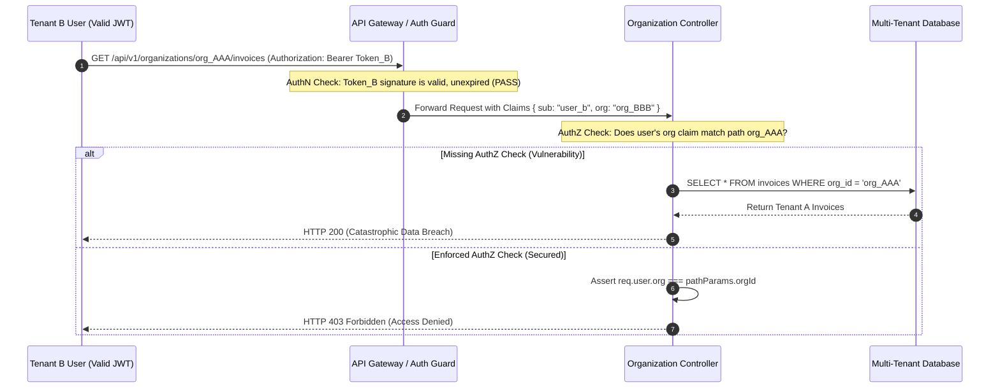

## Fast Revision (10-Second Recall)
- **AuthN vs AuthZ:** Authentication verifies identity (who you are); Authorization verifies permissions (what you are allowed to perform).
- **Core AuthN Test Vectors:** Expired tokens, invalid/tampered cryptographic signatures, malformed headers, replay attacks, revoked refresh tokens.
- **Core AuthZ Test Vectors:** Vertical privilege escalation (User accessing Admin endpoints), horizontal privilege escalation (User A accessing User B's tenant resources/BOLA/IDOR), missing role checks.
- **Test Matrix Approach:** Execute standard endpoint test suites parameterized across an identity matrix: Anonymous, Standard User, Cross-Tenant User, Admin, Revoked User.
- **Contract Boundary:** Isolate identity provider (IdP / OAuth2 / OIDC) token generation from local cryptographic signature verification in integration suites.

## The 30-Second Spoken Script
> "Testing authentication and authorization requires distinct strategies for identity verification and access permissions.
>
> For **Authentication (AuthN)**, we test the token lifecycle and cryptographic boundaries. We assert that endpoints reject unauthenticated requests with HTTP 401, verify that expired or unsigned JWT tokens are rejected immediately, test token refresh rotation, and ensure revoked sessions cannot access cached endpoints.
>
> For **Authorization (AuthZ)**, we test against vertical and horizontal privilege escalation. For vertical access, we verify that non-privileged roles cannot access administrative endpoints, returning HTTP 403. For horizontal access—often known as Broken Object Level Authorization (BOLA/IDOR)—we assert that User A cannot read or mutate User B's resources, even with a valid token.
>
> We automate this in CI using parameterized test fixtures with predefined roles (Admin, Editor, Viewer, Cross-Tenant) and test against an ephemeral local JWT signing key pair to maintain fast, deterministic security validation without calling external OAuth providers."

## Scenario / Problem Context
A SaaS multi-tenant project management platform suffered a critical data leak. A standard user discovered that by altering the `organizationId` parameter in an API request:
`GET /api/v1/organizations/org_999/billing`
they could download the financial statements and credit card metadata of a rival enterprise company.

The application middleware validated that the JWT token was signed and valid (AuthN passed), but the controller lacked organization tenancy verification (AuthZ failed). Additionally, the QA test suite only tested "Happy Path" scenarios where an Admin performed actions on their own organization. Negative security test cases across roles and cross-tenant boundaries were completely missing.

## Architectural Workflow / Sequence


## Deep-Dive Analysis & Root Causes

### 1. Distinct HTTP Status Semantics
- **HTTP 401 Unauthorized:** Missing, expired, malformed, or cryptographically invalid credentials. The caller is unauthenticated.
- **HTTP 403 Forbidden:** The caller is successfully authenticated, but lacks sufficient permissions or role privileges to perform the action.

### 2. Broken Object Level Authorization (BOLA / IDOR)
BOLA remains the number one API vulnerability on the OWASP Top 10. Developers often enforce `@UseGuards(JwtAuthGuard)` to verify that the caller is logged in, but fail to enforce `@UseGuards(TenantOwnershipGuard)` or database row-level security. The test suite must actively assert cross-user isolation.

### 3. JWT Boundary Vectors to Test
- **Signature Tampering:** Modifying the payload without resigning with the private secret.
- **Algorithm Confusion Attack:** Sending `"alg": "none"` or changing `RS256` to `HS256` using the public key as the HMAC secret.
- **Clock Skew / Expiration (`exp`):** Ensuring expired tokens fail even with a 1-second delta.
- **Audience (`aud`) & Issuer (`iss`):** Tokens generated for Service A must not be accepted by Service B.

## Practical Debugging Commands & Code

### Step 1: Generate Deterministic Mock JWTs for Testing
Use a local RSA or HMAC key pair in test utilities to simulate any user claim instantly:

```typescript
// test-helpers/authHelper.ts
import jwt from 'jsonwebtoken';

const TEST_SECRET = 'ci-test-jwt-secret-key-32-bytes-minimum!';

export interface TestUserClaims {
  userId: string;
  email: string;
  role: 'ADMIN' | 'MEMBER' | 'GUEST';
  organizationId: string;
}

export function generateTestToken(claims: Partial<TestUserClaims>, expiresIn: string | number = '1h'): string {
  const defaultClaims: TestUserClaims = {
    userId: 'usr_default_123',
    email: 'test@company.internal',
    role: 'MEMBER',
    organizationId: 'org_alpha',
    ...claims,
  };

  return jwt.sign(defaultClaims, TEST_SECRET, {
    algorithm: 'HS256',
    issuer: 'https://auth.company.internal',
    expiresIn,
  });
}
```

### Step 2: Parameterized Integration Test Suite for AuthN & AuthZ
Validate endpoints across all permission permutations using Supertest and Jest:

```typescript
// tests/organizations.auth.spec.ts
import request from 'supertest';
import { app } from '../src/app';
import { generateTestToken } from '../test-helpers/authHelper';

describe('AuthN & AuthZ Verification: /api/v1/organizations/:orgId/billing', () => {
  const targetOrgId = 'org_alpha';

  // 1. Authentication (AuthN) Tests
  describe('Authentication Boundary', () => {
    it('returns 401 when Authorization header is completely missing', async () => {
      const res = await request(app).get(`/api/v1/organizations/${targetOrgId}/billing`);
      expect(res.status).toBe(401);
      expect(res.body.error).toMatch(/Missing or malformed authorization token/);
    });

    it('returns 401 when token is expired', async () => {
      // Token expired 10 seconds ago
      const expiredToken = generateTestToken({ organizationId: targetOrgId }, -10);
      const res = await request(app)
        .get(`/api/v1/organizations/${targetOrgId}/billing`)
        .set('Authorization', `Bearer ${expiredToken}`);
      
      expect(res.status).toBe(401);
      expect(res.body.error).toMatch(/jwt expired/);
    });

    it('returns 401 when signature is tampered', async () => {
      const validToken = generateTestToken({ organizationId: targetOrgId });
      const tamperedToken = validToken.slice(0, -6) + 'abc123';
      
      const res = await request(app)
        .get(`/api/v1/organizations/${targetOrgId}/billing`)
        .set('Authorization', `Bearer ${tamperedToken}`);
      
      expect(res.status).toBe(401);
    });
  });

  // 2. Authorization (AuthZ) Tests
  describe('Authorization & Tenant Isolation Boundary', () => {
    it('returns 403 when authenticated user belongs to a DIFFERENT organization (Anti-IDOR)', async () => {
      // User belongs to org_beta, attempting to access org_alpha
      const crossTenantToken = generateTestToken({
        userId: 'usr_attacker_666',
        role: 'ADMIN',
        organizationId: 'org_beta',
      });

      const res = await request(app)
        .get(`/api/v1/organizations/${targetOrgId}/billing`)
        .set('Authorization', `Bearer ${crossTenantToken}`);

      expect(res.status).toBe(403);
      expect(res.body.error).toMatch(/Forbidden: Tenant access mismatch/);
    });

    it('returns 403 when authenticated user belongs to target org but lacks ADMIN role', async () => {
      // User is in org_alpha, but is only a MEMBER
      const memberToken = generateTestToken({
        userId: 'usr_member_111',
        role: 'MEMBER',
        organizationId: targetOrgId,
      });

      const res = await request(app)
        .get(`/api/v1/organizations/${targetOrgId}/billing`)
        .set('Authorization', `Bearer ${memberToken}`);

      expect(res.status).toBe(403);
    });

    it('returns 200 when authenticated user is an ADMIN of the target organization', async () => {
      const adminToken = generateTestToken({
        userId: 'usr_admin_001',
        role: 'ADMIN',
        organizationId: targetOrgId,
      });

      const res = await request(app)
        .get(`/api/v1/organizations/${targetOrgId}/billing`)
        .set('Authorization', `Bearer ${adminToken}`);

      expect(res.status).toBe(200);
      expect(res.body).toHaveProperty('invoices');
    });
  });
});
```

### CLI Command: Automated Security Linter Checks
```bash
# Scan routes for missing authorization middleware using AST rules
npx eslint --rule 'security/detect-object-injection: error' src/controllers/

# Check open API specs for exposed unauthorized paths
npx spectral lint openapi.yaml --ruleset=spectral:oas
```

## Prevention & Senior Best Practices
1. **Deny-by-Default Architecture:** Configure all router middleware so routes require explicit authentication and authorization decorators; unannotated routes must reject requests by default.
2. **Automate Matrix Testing:** Every new API endpoint should have a parameterized test suite covering 5 identities: Unauthenticated (401), Unauthorized Role (403), Foreign Tenant (403), Valid Role (200), and Super Admin (200).
3. **Enforce Database Row-Level Security (RLS):** In addition to controller-level checks, use PostgreSQL Row-Level Security (`ALTER TABLE documents ENABLE ROW LEVEL SECURITY`) bound to the current session tenant variable.
4. **Decouple Policy from Code:** Use Open Policy Agent (OPA) or Oso for complex attribute-based access control (ABAC) rules, allowing security policies to be tested and audited independently of application code.
5. **Continuous Dynamic Application Security Testing (DAST):** Run automated scanners such as OWASP ZAP in staging pipelines to actively fuzz authorization headers and parameter IDs.

