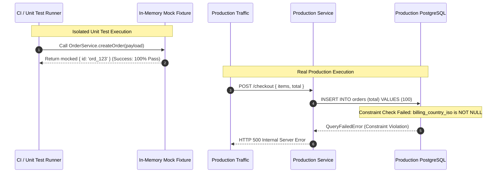

## Fast Revision (10-Second Recall)
- **Primary Culprit:** Unit tests verify isolated component logic against assumed mocks, not real I/O, environmental configurations, network latencies, or stateful concurrency.
- **Mock Drift:** External API schemas, database constraint changes, or ORM driver quirks diverge from synthetic mock fixtures.
- **Environment Variance:** Differences in Node/JVM runtimes, OS system limits (`ulimit -n`), TLS cipher negotiations, or missing environment variables break runtime execution.
- **Concurrency & State:** Production experiences distributed race conditions, deadlocks, and connection exhaustion that single-threaded in-memory unit suites never exercise.
- **Remediation:** Enforce the test pyramid with contract testing (Pact), automated containerized integration tests (Testcontainers), and realistic staging smoke tests.

## The 30-Second Spoken Script
> "When unit tests pass but production crashes, the core failure is a breakdown in testing fidelity. Unit tests isolate software components using mocks, stubs, and synthetic inputs. They validate pure business logic, but they completely ignore the boundary interfaces where 80% of production bugs occur.
>
> In practice, production failures despite green unit tests trace back to four root causes: first, **mock drift**, where third-party API contracts or DB schemas changed but mocks remained stale; second, **environmental discrepancies**, such as missing runtime environment variables, incompatible database drivers, or OS resource limits; third, **data scale and statefulness**, such as unhandled null records, large payloads blowing up heap buffers, or SQL connection pool starvation; and fourth, **network and concurrency realities**, like socket timeouts, race conditions, and distributed deadlocks.
>
> To eliminate this gap, we implement containerized integration tests using Testcontainers, enforce consumer-driven contract tests with tools like Pact, and introduce pre-release canary testing with synthetic traffic."

## Scenario / Problem Context
An e-commerce payments microservice deployed to production with 98% test coverage and zero test failures. Five minutes after switching production traffic to the new build, 45% of user checkout requests fail with HTTP 500 errors. 

The application logs display:
```text
UnhandledPromiseRejection: QueryFailedError: null value in column "billing_country_iso" of relation "orders" violates not-null constraint
    at PostgresQueryRunner.query (/app/node_modules/typeorm/driver/postgres/PostgresQueryRunner.js:211:19)
    at OrderRepository.createOrder (/app/dist/repositories/OrderRepository.js:45:12)
```

The developer's unit test for `OrderService.createOrder` passed cleanly:
```typescript
it('should successfully create an order', async () => {
  const mockRepo = {
    save: jest.fn().mockResolvedValue({ id: 'ord_123', status: 'PENDING' })
  };
  const service = new OrderService(mockRepo);
  const result = await service.createOrder({ total: 100 });
  expect(result.id).toBe('ord_123');
  expect(mockRepo.save).toHaveBeenCalled();
});
```

The unit test passed because the repository was completely mocked out! The mock ignored database constraints, schema migrations, and column requirements added in a parallel database migration.

## Architectural Workflow / Sequence


## Deep-Dive Analysis & Root Causes

### 1. The Mocking Paradox & Contract Drift
Unit tests substitute real external systems (databases, HTTP APIs, caches, message brokers) with test doubles (mocks/stubs). When the real dependency evolves (e.g., Stripe alters an error payload shape, or a DBA sets a column to `NOT NULL`), the unit test mock continues returning obsolete structures. The code is proven correct against a fantasy system.

### 2. Environmental & Configuration Divergence
- **Missing Secrets & Environment Variables:** A service expects `REDIS_CLUSTER_URL`, but production only configured `REDIS_HOST`.
- **Driver Version Mismatches:** Local unit tests run on Node v20 with mocked drivers; production runs in a distroless container with Alpine musl libc causing native C++ bindings to crash.
- **Connection Pool Exhaustion:** Local suites execute sequentially with 1 active query; production saturates the 20-connection pool under 500 requests/sec.

### 3. Data Volumetrics & Edge Cases
Unit tests test "happy paths" with clean, trimmed strings: `{ email: "test@domain.com" }`. Production receives UTF-8 emojis, multi-megabyte JSON payloads that exceed body-parser limits, or legacy records containing null values in unmigrated legacy fields.

### 4. Distributed Concurrency & Timing
Unit tests run deterministically in a single process. Production runs across multiple Kubernetes pods where concurrent writes trigger database serialization failures (`40001: could not serialize access due to concurrent update`) or Redis distributed lock race conditions.

## Practical Debugging Commands & Code

### Step 1: Diagnose Missing Runtime Configurations & Constraints
Inspect production container environment variables and schema discrepancies:
```bash
# Verify environment variables inside running Kubernetes pod
kubectl exec -it deployment/order-service -n production -- env | grep -E "DATABASE_|REDIS_|API_KEY"

# Check recent migration status directly against the DB
kubectl exec -it deployment/order-service -n production -- npm run typeorm migration:show

# Inspect Postgres constraints directly
psql -h postgres-prod.internal -U app_user -d commerce -c "\d+ orders"
```

### Step 2: Implement Real Integration Testing with Testcontainers
Replace brittle unit mocks with containerized, ephemeral PostgreSQL databases executed inside CI:

```typescript
import { PostgreSqlContainer, StartedPostgreSqlContainer } from '@testcontainers/postgresql';
import { DataSource } from 'typeorm';
import { Order } from '../entities/Order';
import { OrderRepository } from '../repositories/OrderRepository';

describe('OrderRepository (Real Integration)', () => {
  let container: StartedPostgreSqlContainer;
  let dataSource: DataSource;
  let repo: OrderRepository;

  beforeAll(async () => {
    // Spin up a clean, real PostgreSQL instance in Docker
    container = await new PostgreSqlContainer('postgres:16-alpine')
      .withDatabase('testdb')
      .withUsername('test')
      .withPassword('test')
      .start();

    dataSource = new DataSource({
      type: 'postgres',
      host: container.getHost(),
      port: container.getPort(),
      username: container.getUsername(),
      password: container.getPassword(),
      database: container.getDatabase(),
      entities: [Order],
      synchronize: true, // Applies actual table DDL constraints
    });

    await dataSource.initialize();
    repo = new OrderRepository(dataSource);
  }, 30000);

  afterAll(async () => {
    await dataSource.destroy();
    await container.stop();
  });

  it('fails fast when billing_country_iso is omitted (reproducing prod bug)', async () => {
    const invalidPayload = { totalAmount: 150 };

    // This correctly rejects because real DB enforces NOT NULL constraint
    await expect(repo.createOrder(invalidPayload as any)).rejects.toThrow(
      /violates not-null constraint/
    );
  });
});
```

### Step 3: Enforce Schema Contract Testing with Zod at Boundaries
Prevent unvalidated payloads from ever touching repositories:

```typescript
import { z } from 'zod';

export const CreateOrderSchema = z.object({
  total: z.number().positive(),
  billingCountryIso: z.string().length(2, 'Must be 2-letter ISO code'),
  currency: z.enum(['USD', 'EUR', 'GBP']).default('USD'),
});

export type CreateOrderInput = z.infer<typeof CreateOrderSchema>;

export function validateOrderInput(raw: unknown): CreateOrderInput {
  const result = CreateOrderSchema.safeParse(raw);
  if (!result.success) {
    throw new BadRequestError(`Validation failed: ${result.error.message}`);
  }
  return result.data;
}
```

## Prevention & Senior Best Practices
1. **Rebalance the Test Pyramid:** Reduce reliance on heavy unit mocking. Unit tests should validate pure algorithms, domain logic, and mathematical transformations. Integration tests must validate database queries, cache read/writes, and external HTTP contracts.
2. **Mandate Testcontainers in CI:** Execute database, Redis, and Kafka integration tests against isolated Docker containers in the pull request pipeline.
3. **Consumer-Driven Contract Testing:** Utilize Pact or OpenAPI schema validation to automatically fail builds if producer and consumer API contracts drift.
4. **Automated Smoke Testing Post-Deploy:** Implement automated synthetic probes that fire real transactions through the canary environment before releasing traffic to 100% of the fleet.
5. **Config & Secret Linters:** Run configuration verification during build time (e.g., using `@t3-oss/env-core` or Joi) to assert that every required production secret and environment variable is declared and formatted correctly before boot.

